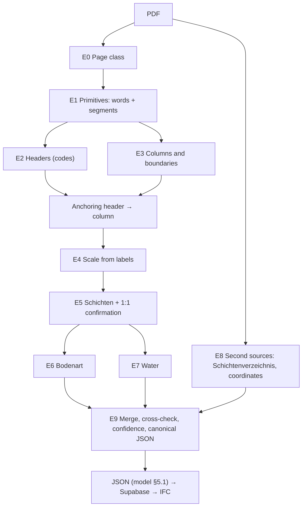

# Extraction algorithm v4 (specification)

**What this note is for:** describe the algorithm precisely enough to reimplement it in
`geo_agent/` without reading the prototype. Each stage says what it receives, what it delivers,
which parameters it uses and **why** (lesson from [16](16_lessons_learned.md)). Reference
implementation: [`prototyp_v4.py`](../services/extractor/prototyp_v4.py). The rules can be
switched off one by one (`RULES`) to measure their effect.

**Guiding principle (goal):** every value that comes out goes to the Baugrundmodell with
**provenance** (page, bbox, method) and **confidence**. If something cannot be confirmed, it is
marked; it is not invented.

## Overview

All coordinates are in the system of the page's **view** (rotation applied) and in PDF points; depth
is in m below the start (GOK).

## E0. Page class

| Class | Condition | Consequence |
|---|---|---|
| `raster` | images cover > 45 % and < 10 words inside them | segments from the image + **OCR** |
| `raster_ocr` | images > 80 % (scan with an OCR layer, even if it carries vector noise, E2) | image **and** vector segments; text from the layer **+ our own OCR** where the layer has no words (L18b) |
| `vektor_ohne_text` | ≥ 150 drawings and < 25 words (AutoCAD SHX) | vector segments + **OCR** |
| `vektor` | everything else | all native |

Lessons E1, E2, L11, L17, L18. OCR: RapidOCR (ONNX, Apache-2.0); adaptive resolution (≈ 3300 px on
the long side, between 200 and 300 dpi, for reduced pages); boxes with confidence < 0.5 and those
overlapping native words by > 30 % are discarded; cache per page image.

## E1. Primitives

- **Words:** `(rect, text, block, line)`. OCR boxes are one line; their words get an x range
  proportional to their position in the string. Words within each `(block, line)` are joined in
  **reading order** (rule `line_reading_order`, E9, Issue #49): by MuPDF's `word_no` (`w[7]`, which
  follows the line's writing direction `dir` on horizontal, rotated and vertical text; fallback to
  the line's main axis `x0` / `y0`, never `(y0, x0)`). This makes line assembly invariant to
  sub-point baseline/ascender shifts across PyMuPDF versions (2.0 vs 2.1).
- **Segments:** every path (line, rectangle, quad) is broken into segments with width, stroke and
  dash pattern (L1). In raster, horizontal/vertical morphological opening with a kernel of ~3 mm;
  lines ≤ 10 px thick (L11).
- **Rotation:** words and paths × `page.rotation_matrix` (L2).

## E2. Headers

Accepted, in this order:
1. Line `^<PREFIX> <n>[a-z][/yy]( - text)?$` with the prefixes `B BK KB KRB RKS BS GWM SCH` (L13: the
   suffix `- Betonweg 0+050` is ignored).
2. Archive: `^S <n>[a-z]$` (`S 2a`).
3. Generic: `Bohrung`, `<Word>bohrung` (`Sondierbohrung`, `Rotationskernbohrung`), `Bohrprofil`,
   `Aufschluss`, `Rammkernsondierung`, followed by the code on the same line
   (`Sondierbohrung : SST KB 5`) or on the row below (≤ 14 pt), joining the blocks of that row
   (`RB` + `2 / I`). Code: capitals/digits/`./-`, ≤ 16 characters, with at least one digit, and not a
   date or a depth (T1).

Codes are compared without spaces (`B1` = `B 1`), because OCR loses them.

## E3. Columns and boundaries

- **Edges:** stroked verticals, collinear ones merged (gap ≤ 1.5 pt), length ≥ 30 pt.
- **Column:** pair of edges with 8 ≤ width ≤ 80 pt, height ≥ 2.5 × width and overlap ≥ 90 % (G1).
- **Boundaries:** continuous horizontals (not dashed, G2) that cover the column from edge to edge
  with a tolerance of 0.6 pt; lines less than 0.8 pt apart are merged (1.6 pt in raster).
- **Nested:** the one with the thickest edges is kept (G3).
- **Anchoring:** each header takes the column whose centre is less than 70 pt away in x and that
  lies **below** it, without a vertical limit (L4); preference: edge thickness, number of
  boundaries, closeness.
- **Table:** a column with > 2 words with digits inside is a table (G4); `000` tokens that OCR reads
  in the Schraffur of Kies are ignored (E4). A column with ≥ 3 depths inside is the depth column of
  the form and is not anchored (T5).
- **Sheet with a single header** and no anchoring: it is anchored to the column with the most
  labels (or the best straight line of labels, T4), even if the header is far away (T3); the GOK is
  then searched in the title block of the whole page, joining blocks on the same row (S7).

## E4. Vertical scale (depth = a·y + b)

1. **Label groups:** numbers `\d{1,3}[.,]\d{1,2}( ?m)?` ≤ 150, inside the vertical band of the column
   (−8 / +150 pt) and ≤ 110 pt away; each number goes to its nearest column. They are grouped by x
   (4 pt steps) and sorted; the longest non-decreasing subsequence is kept.
2. **Group filters:** arithmetic progression (≥ 5 values, same step ± 0.011) with a round step and
   ≥ 8 values, or with more values than the column has boundaries = **axis**, not labels (L14);
   ≥ 6 values with ≤ 70 % distinct = **Von/Bis pairs** of samples (L15).
3. **Candidates:**
   - *direct*: the label rests on a boundary (base or centre within 4.5 pt) in ≥ 60 % of the cases;
     regression with (top, 0) added.
   - *by order*: k-th label ↔ k-th boundary, dropping up to 3 boundaries; max. residual < 3 cm
     (accepts < 6 cm). If the first label is > 0, the top = 0 is added.
   - *scale text*: `M 1:50`, `Höhenmaßstab 1:30` → a = scale · 0.3528 mm, b from the top.
   - *OCR ruler* (rule `raster_massstab_ocr`, E8, Issue #40): on scanned pages (`pcls != "vektor"`),
     `raster_ruler_scale` searches for vertical depth rulers (`0..30 m`, top within 35 pt of
     `col.bounds[0]`) and elevation rulers (`-50..3000 m NHN`, converted via `depth = gok - elev`)
     within 220 pt of the column (600 pt on sections with ≥ 2 anchored columns). Requires ≥ 4
     vertically aligned OCR numbers (`Δx ≤ 14 pt`, `Δy ≥ 8 pt`) in arithmetic progression
     (`step ± 0.035` or 6 %, round step in `{0.1, 0.2, 0.25, 0.3, 0.5, 1, 2, 2.5, 5, 10}`, linear
     fit `R² ≥ 0.995`, `0.002 ≤ a ≤ 0.25`). Depth rulers are excluded from `label_groups` (L14) so
     ruler ticks never become Schicht boundaries.
4. **Admissibility:** normalised scale (±4 %) or, otherwise, ≥ 80 % of ≥ 3 labels confirmed (L9).
5. **Choice:** maximum number of confirmed labels (tolerance 3 cm); tie-break direct > order > text
   (L3).
6. **Column without labels:** if another column on the page has them, it is discarded (GWM
   construction, L15b); if none has them (OCR lost), the title-block scale is accepted and marked.
7. **Label first (T4):** if < 50 % of ≥ 5 labels are confirmed by lines, a straight line value ↔
   label position is fitted; outliers are trimmed (up to 25 %) until the residual is ≤ 0.2 m, and the
   scale must be normalised. The boundaries are the **printed values** (outliers with a residual
   ≤ 1 m are still data, e.g. stacked labels; > 1 m, like an elevation `52,35`, are not); each one is
   confirmed if there is a line within 0.3 m. Among duplicates, this mode loses against one where
   lines and labels agree. With ≥ 8 labels on a straight line a non-normalised scale is also
   accepted (reduced printed PDF).
8. **Contradiction (E5, E8):** if only the title-block scale is left and < 30 % of ≥ 3 labels confirm
   it, the Bohrung is emitted **without Schichten** and with the warning "Massstabstext und
   Tiefenlabels widersprechen sich" (reduced or recomposed PDF). Among duplicates a version with
   Schichten wins. If `raster_ruler_scale` finds a depth ruler whose slope `a` differs by > 12 % from
   the boundary labels (`label_line` slope or `max(v) / (col.bounds[-1] - col.bounds[0])`), the scale
   is rejected and the Bohrung is emitted without Schichten and without water with the warning
   "Tiefenlineal und Grenzbeschriftungen widersprechen sich: Massstab verworfen". Conversely, on scans
   where coloured/hatched interior layer lines vanish at 150 dpi so only top and base remain
   (`len(col.bounds) ≤ 2`), when `raster_massstab_ocr` is enabled and `M 1:n` + `gok` or the OCR
   elevation ruler confirms the column end depth `a · (col.bounds[-1] - col.bounds[0]) ≈ max(v)`
   within `max(0.35 m, 8 %)` (or `label_line` slope within 12 %), that scale is kept (`scale_text` or
   `ocr_ruler`) to compute water-symbol depths without inventing unconfirmed interior Schichten.

## E5. Schichten

- Each boundary is confirmed **1:1** with the closest label within 3 cm (G5). If it is confirmed,
  the depth that comes out is **the printed value** (not the geometry, which has ±1 pt of error).
- Unconfirmed boundary → Schicht with the issue `Grenze ohne bestaetigendes Label`.
- **Schraffur lines** (only with label support ≥ 60 %), L6:
  - *companion line*: unconfirmed within 2.5 pt of a confirmed one → removed;
  - *double line*: two unconfirmed ones within 8 pt with no Schraffur between them (Schwarzdecke) →
    removed.

  What is removed stays in the `issues` of the Bohrung.

## E6. Bodenart

For the text assigned to the Schicht (by interval and, if the labels mark the top with 0.00, by
label, L3):
1. First **noun** (capitalised, not an adjective in `-ig/-haltig/-lich`): `Oberboden/Mutterboden` →
   Mutterboden; man-made (`Beton`, `Asphalt`, `Schwarzdecke`, `Pflaster`, `Auffüllung`,
   `Anschüttung`, `Schotter`); rock `-stein`/`-fels` → `Fels (…)`; otherwise the `soil.classify`
   table (L7).
2. If there is no noun: the initial DIN 4023 / EN ISO 14688 **abbreviation** (`U`, `fS`, `G`, `A`,
   `Mu`, `Sa`, `Gr`, `Si`, `Cl`, …) (L16).
3. The original text is kept (`description_raw`).

## E7. Water

1. **Symbol:** triangle of 3 segments (3–16 pt) with the vertex down, inside the vertical range of
   the column; the end of the **water line** decides the Bohrung (W1). Not water: series of ≥ 3
   triangles at the same x (ruler), triangles with an elevation `741,00` to the right, and depth
   ≤ 5 cm (GOK) (L10).
2. **Text:** `GW 2.53m`, `… m u. GOK` near the Bohrung; `Wasseranschnitt 3.8`, `Wasserstand`,
   `Wasserspiegel` in the description of the Schicht (L10b).
3. **No water:** `kein (Grund)wasser`, `GW nicht angetroffen`, `trocken` → `gw_status` (W2).
4. **Kind and date** (rule `gw_art`, Issue #26, 2026-11-19): per level from the text that names it — the row at the
   symbol (centre within 9 pt of the vertex, starting within 90 pt of it), the `GW …` text, the description of the
   Schicht, or the Schichtenverzeichnis (25 characters before the match, 30 after). Keywords, in this order:
   `Schichten-/Stau-/Sickerwasser` → Schichtenwasser; `Bohrende` → Bohrende; `Ruhewasser`, `angestiegen` →
   Ruhewasser; `angetroffen`, `angebohrt`, `Anschnitt`, `Wasserzutritt` → angetroffen. No keyword → `unbestimmt`
   (never guessed). Date `dd.mm.yy(yy)` with a valid day and month (`02.99` is not a date). The profile wins; the
   Schichtenverzeichnis fills a missing kind or date at the same depth (± 3 cm). The text read stays as `evidence`.
   The Schichtenverzeichnis also reads `Ruhewasser 3.62m` (before: only `Wasserstand`, `Wasserspiegel`,
   `Grundwasser…`, `GW`).
4b. **Legend symbols** (rule `gw_legende`, W3, Issue #20): the legend of the page maps shapes to kinds (filled
   triangle, open triangle, roof Λ of two strokes) by the water text next to them. A roof standing on a water line
   counts as a level only when the legend knows it; its depth is the base. The kind from the legend applies only where
   the text at the symbol gave none, with evidence "Legende: Symbol …".
4c. **Water symbols in scans** (rules `raster_gw_symbol`, `raster_gw_legende`, W4, Issue #20, 2026-11-19): runs only on
   scanned pages with anchored columns (or a linear `depth_table` Bohrprofil whose label baselines `r.y1` fit a straight
   line within ≤ 0.15 m, separating scaled profiles without dark column outlines as in E7 from non-scaled text tables
   like A7367 at 1.13 m residual). At 200 dpi it extracts horizontal lines ≥ 15 pt (union of dark `< 155` and thin
   anti-aliased `< 215` lines after vertical-opening fill removal), skips lines inside or crossing a column or > 105 pt
   away, and runs multi-scale `cv2.matchTemplate` (`TM_CCOEFF_NORMED` ≥ 0.62) for filled, open and half-filled
   triangles plus roofs Λ (only when `raster_gw_legende` finds Λ in the 92 × 32 pt band left of water legend text and
   `gw_legende` confirms it). Every candidate passes geometric verification (contrast ≥ 60, dark upper corners and
   downward taper to reject circles/boxes, three edges ≥ 75 %, white exterior ≤ 15 %, clean space above ≤ 18 %, outside
   all columns, no periodic horizontal pattern ≥ 3, water line ending ≤ 100 pt from the target column without crossing
   it) and enters `_groundwater` with ±2 pt vertical ruler clustering and OCR elevation filtering. Runtime overhead on
   scanned PDFs: 55–202 ms/page overall (0 ms/page on vector PDFs).

   Measured before / after (`prototyp_v4.py`, `constraints.txt` PyMuPDF 2.0, `GEO_OCR_CACHE`):

   | PDF / Set | `real` GW (before → after) | `real` false GW | `raster150` GW (before → after) | `raster150` false GW | `raster150` runtime (ms/p total · W4) |
   |---|---:|---:|---:|---:|---:|
   | `16132` (2 p.) | 0/0 → 0/0 | 0 → 0 | 0/0 → 0/0 | 0 → 0 | 1400 · 0 |
   | `A7367` (1 p.) | 0/0 → 0/0 | 0 → 0 | 0/0 → 0/0 | 0 → 0 | 1600 · 0 |
   | `berlin_v67b` (33 p.) | 2/2 → 2/2 | 0 → 1* | 1/2 → 1/2 | 0 → 1* | 2102 · 202 |
   | `clipping_test` (1 p.) | 0/0 → 0/0 | 0 → 0 | 0/0 → 0/0 | 0 → 0 | 2400 · 0 |
   | `example_borehole_profile` (1 p.) | 0/0 → 0/0 | 0 → 0 | 0/0 → 0/0 | 0 → 0 | 3300 · 0 |
   | `halle` (17 p.) | 0/0 → 0/0 | 0 → 0 | 0/0 → 0/0 | 0 → 0 | 1006 · 0 |
   | `hausham` (61 p.) | 4/4 → 4/4 | 0 → 0 | **0/4 → 4/4** | 0 → 0 | 1860 · 140 |
   | `marl_251` (62 p.) | 0/0 → 0/0 | 0 → 0 | 0/0 → 0/0 | 0 → 0 | 1150 · 0 |
   | `rednitzhembach` (36 p.) | 0/0 → 0/0 | 0 → 0 | 0/0 → 0/0 | 0 → 0 | 1883 · 55 |
   | `talheim` (22 p.) | 4/4 → 4/4 | 0 → 0 | 0/4 → 0/4† | 0 → 0 | 1934 · 122 |
   | `triefenstein_bp41` (51 p.) | 2/2 → 2/2 | 0 → 0 | 0/2 → 0/2‡ | 0 → 0 | 992 · 0 |
   | `wachenroth` (59 p.) | 0/0 → 0/0 | 0 → 0 | 0/0 → 0/0 | 0 → 0 | 959 · 0 |
   | `wesel_anlage12` (17 p.) | 0/0 → 0/0 | 0 → 0 | 0/0 → 0/0 | 0 → 0 | 1006 · 0 |
   | **Sum `real` / `raster150` (13)** | **12/12 → 12/12** | **0 → 1*** | **1/12 → 5/12** | **0 → 1*** | **~1130 · 55–202** |
   | `rot90` (13) | 12/12 → 12/12 | 0 → 1* | — | — | — |
   | `scale70` (13) | 8/12 → 8/12 | 0 → 3* | — | — | — |
   | `stress` s01–s19 | **7/8 → 8/8** | 0 → 0 | — | — | — |
   | `stress` s20–s23 (new) | — → **3/3** | — → 0 | — | — | — |
   | `synth` (6) | 17/17 → 17/17 | 0 → 0 | — | — | — |

   *Notes:*
   - Review by Claude (2026-11-20): the Berlin archive levels below were checked on the page images and added to
     `benchmark/groundtruth/berlin_v67b.json`. With that ground truth, every column marked `*` reads 0 false GW
     (`real` Berlin GW 3/8; `raster150` on the five PDFs with water 1/18 → 6/18).
   - `*` `berlin_v67b`: all flagged `falsches GW` are genuine printed DIN 4023 water symbols on untranscribed archive
     scans (`layers_transcribed: false`, `gw_depths: []` in `benchmark/groundtruth/berlin_v67b.json`;
     `benchmark/eval_real.py:71` still scores `gw_false`): `S 2a` p. 30 (`▽ 3,86 m`, `32,82 m NN`, extracted `3.86 m` in
     `real`/`raster150`/`rot90`), `S 1` p. 30 (`▽ 8,87 m`, extracted `8.87 m` in `scale70`), and `B 1/17` p. 32
     (`▼ 2,40 m` and `▽ 3,40 m` `06.09.2017`, extracted `2.41 m` and `3.40 m` in `scale70`). Genuine false GW = **0**.
   - `†` `talheim` (`raster150`): `raster_gw_symbols` + `raster_gw_legende` detect all 4/4 symbols (incl. roof Λ via
     the scanned legend), but E5 (`scale_contradiction`) leaves BK1–BK3 without a scale at 150 dpi.
   - `‡` `triefenstein_bp41` (`raster150`): `raster_gw_symbols` detects both half-filled triangles (p. 20, p. 23), but
     all 5 Bohrungen are extracted from the scanned Schichtenverzeichnis (`mode = schichtenverzeichnis`).
   - Ablation (`ablation.py` on `stress` s01–s23 + `synth`): `raster_gw_symbol` protects `s12_raster` (1/1→0/1),
     `s20_raster_gw_symbol` (1/1→0/1), `s23_raster_legende_dach` (2/2→0/2) (plus `raster150/hausham` 4/4→0/4);
     `raster_gw_legende` protects `s23_raster_legende_dach` (2/2→1/2); `gw_symbol_filter` additionally protects
     `s22_raster_dreieck_ohne_linie` (0→1 false GW).
4d. **Water levels in scans from OCR depth scale and from the Schichtenverzeichnis** (rules `raster_massstab_ocr`,
   `sv_wasser`, E8/W5, Issue #40, 2026-11-22):
   - *OCR depth scale (`raster_massstab_ocr`)*: supplies a vertical scale from an OCR depth/elevation ruler
     (`raster_ruler_scale`) or retains `M 1:n` + `gok` when coloured/hatched interior layer lines vanish in a scan
     (`len(col.bounds) ≤ 2`) and the column bottom depth `a · (col.bounds[-1] - col.bounds[0])` matches `max(v)` within
     `max(0.35 m, 8 %)` (`talheim` `raster150` `BK1..BK3`, `berlin_v67b` `B 1/17`). A ruler whose slope contradicts
     boundary labels (`label_line` or `col.bounds` ↔ `max(v)`) by `> 12 %` is rejected with the issue
     `"Tiefenlineal und Grenzbeschriftungen widersprechen sich: Massstab verworfen"` (`s25_raster_lineal_widerspruch`).
     In `raster_gw_symbols`, unanchored phantom rectangles sharing a vertical edge with an anchored column (such as the
     vertical water-rise arrow next to `BK2` in `talheim`) are excluded from `real_cols` so they do not mask the water
     line or symbol.
   - *Water sentences in the Schichtenverzeichnis (`sv_wasser`)*: on single-Bohrung DIN 4022 pages
     (`len(hdr_codes) == 1`), full-page y-sorted lines in scans interleave Column 1 layer depths (`3,30` in
     Triefenstein p. 22) and Column 6 sample depths (`2.50` in Hausham p. 32) into the middle of Column 3 water sentences
     (S2). `schichtenverzeichnis` reads Column 3 (`Wasserführung / Bohrwerkzeuge`, `x_col3 - 25 ≤ x < x_col4`) and
     Column 2 (`x_a - 2 ≤ x < x_col3 - 4`) as separate vertical cells (`Δy ≤ 16 pt`), matches `SV_GW_FULL_RE`
     (`Wasser angetroffen/angebohrt/eingemessen/nach Bohrende/nach Sondierung/bei/in`,
     `Wasserstand/-spiegel/-anschnitt/-zutritt`, `(Grund|Ruhe|Schichten|Stau|Sicker)wasser*`, `GW` in `m u. GOK/AP`),
     rejects any snippet containing a foreign Bohrung code, and extracts depth, kind (`gw_info`, never guessed), date
     and `evidence`.

   Measured before / after (`prototyp_v4.py`, `GEO_OCR_CACHE`, **0 false GW** across all sets and variants):

   | PDF / Set (pages) | `real` GW (before → after) | `raster150` GW (before → after) | `rot90` GW (before → after) | `scale70` GW (before → after) | `raster150` Bohrungen · Grenzen (before → after) | `raster150` runtime (s · ms/p) |
   |---|---:|---:|---:|---:|---:|---:|
   | `16132` (2 p.) | 0/0 → 0/0 | 0/0 → 0/0 | 0/0 → 0/0 | 0/0 → 0/0 | 0/1 → 0/1 · 0/0 → 0/0 | 2.1s · 1050 |
   | `A7367` (1 p.) | 0/0 → 0/0 | 0/0 → 0/0 | 0/0 → 0/0 | 0/0 → 0/0 | 1/1 → 1/1 · 11/11 → 11/11 | 1.0s · 1000 |
   | `berlin_v67b` (33 p.) | 3/8 → 3/8 | **2/8 → 3/8** | 3/8 → 3/8 | **5/8 → 6/8** | **4/11 → 5/11** · 19/55 → 19/55 | 35.9s · 1088 |
   | `clipping_test` (1 p.) | 0/0 → 0/0 | 0/0 → 0/0 | 0/0 → 0/0 | 0/0 → 0/0 | 0/0 → 0/0 · 0/0 → 0/0 | 0.7s · 700 |
   | `example_borehole_profile` (1 p.) | 0/0 → 0/0 | 0/0 → 0/0 | 0/0 → 0/0 | 0/0 → 0/0 | 1/1 → 1/1 · 14/15 → 14/15 | 2.5s · 2500 |
   | `halle` (17 p.) | 0/0 → 0/0 | 0/0 → 0/0 | 0/0 → 0/0 | 0/0 → 0/0 | 0/0 → 0/0 · 0/0 → 0/0 | 14.2s · 835 |
   | `hausham` (61 p.) | 4/4 → 4/4 | 4/4 → 4/4* | 4/4 → 4/4 | 4/4 → 4/4 | 9/9 → 9/9 · 45/45 → 45/45 | 56.0s · 918 |
   | `marl_251` (62 p.) | 0/0 → 0/0 | 0/0 → 0/0 | 0/0 → 0/0 | 0/0 → 0/0 | 5/12 → 5/12 · 26/97 → 26/97 | 58.7s · 947 |
   | `rednitzhembach` (36 p.) | 0/0 → 0/0 | 0/0 → 0/0 | 0/0 → 0/0 | 0/0 → 0/0 | 4/4 → 4/4 · 15/15 → 15/15 | 34.7s · 964 |
   | `talheim` (22 p.) | 4/4 → 4/4 | **0/4 → 4/4** | 4/4 → 4/4 | 0/4 → 0/4 | 10/10 → 10/10 · 7/65 → 7/65 | 23.0s · 1045 |
   | `triefenstein_bp41` (51 p.) | 2/2 → 2/2 | **0/2 → 2/2** | 2/2 → 2/2 | 2/2 → 2/2 | 5/5 → 5/5 · 24/24 → 24/24 | 48.3s · 947 |
   | `wachenroth` (59 p.) | 0/0 → 0/0 | 0/0 → 0/0 | 0/0 → 0/0 | 0/0 → 0/0 | 6/6 → 6/6 · 18/18 → 18/18 | 54.1s · 917 |
   | `wesel_anlage12` (17 p.) | 0/0 → 0/0 | 0/0 → 0/0 | 0/0 → 0/0 | 0/0 → 0/0 | 1/1 → 1/1 · 24/24 → 24/24 | 16.6s · 976 |
   | **Sum 13 PDFs (363 p.)** | **13/18 → 13/18** | **6/18 → 13/18** | **13/18 → 13/18** | **11/18 → 12/18** | **46/61 → 47/61** · **203/369 → 203/369** | **347.8s · 958** |
   | **False GW (`falsches GW`)** | **0 → 0** | **0 → 0** | **0 → 0** | **0 → 0** | `falsche Bohrungen`: 0 · `falsche Grenzen`: 0 | — |
   | `stress` s01–s23 | 11/11 → 11/11 | — | — | — | 24/24 → 24/24 · 113/121 → 113/121 | 15.8s · 658 |
   | `stress` s24–s27 (new) | — → **2/2** | — | — | — | — → **4/4** · — → **17/22** (s25: 0/5 expected) | 4.7s · 1175 |
   | `synth` (6) | 17/17 → 17/17 | — | — | — | 17/17 → 17/17 · 102/102 → 102/102 | 7.3s · 1217 |
   | **Full regression (`real`+`stress`+`synth`)** | **41/46 → 43/48** | — | — | — | **97/102 → 101/106** · **584/592 → 601/614** (`GW-Status`: 19/22 → 20/23) | **OK: keine Regression** |

   *Notes:*
   - `*` `hausham` (`raster150`): in addition to the 4/4 profile symbols (W4), `sv_wasser` now also reads all 4/4 water
     levels (`3.62 m`, `4.49 m`, `2.53 m`, `2.88 m`) with kind (`Ruhewasser`), date (`29.06.2016`) and `evidence` from
     the scanned Schichtenverzeichnis pages (pp. 32, 34, 48, 52), confirming the profile levels and their kind/date.
   - Ablation (`ablation.py` on `stress` s01–s27 + `synth`):
     - `raster_massstab_ocr` protects `s24_raster_tiefenlineal_gw` (Bohrungen 1/1→0/1, Grenzen 5/5→0/5, Bodenart 5/5→-,
       GOK 1/1→0/1, GW 1/1→0/1) and `s25_raster_lineal_widerspruch` (`falsches GW` 0→1);
     - `sv_wasser` protects `s26_sv_wasserstand` (GW 1/1→0/1);
     - `scale_contradiction` protects `s14_massstab_widerspruch` (`falsche Grenzen` 0→8) and
       `s25_raster_lineal_widerspruch` (`falsches GW` 0→1);
     - `sv_source` protects `s11_shx_sv`, `s26_sv_wasserstand` (GW 1/1→0/1) and `s27_sv_kein_grundwasser`
       (GW-Status 1/1→0/1).
   - Baseline files (`benchmark/baseline_v4.json`, `benchmark/baseline_v4.modul.json`) were intentionally not overwritten
     per assignment rules (Claude updates them after review; `test_baseline_passt_zur_extraktion` in
     `tests/test_hausregeln.py` is therefore expectedly red because `prototyp_v4.py` changed).
5. **Levels of the report text** (not of a Bohrung): `Bemessungswasserstand`, `zeHGW`, `HHGW`, `MHGW`, `HGW`, `MGW`,
   `MNGW` followed within 60 characters by a number with `m NHN` → `wasserstaende` of the document (kind, m NHN,
   page, `quelle: "Text"`, evidence), once per kind and height. A level "auf Geländeoberkante" without a number stays
   in the text. Only the text layer (no OCR for this).
6. **Water lines in the Längsschnitt** (rule `ls_wasserlinien`, W6, Issue #26 part 2b): on vector pages, open blue or
   dashed polylines (`width ≥ 80 pt`, chaining collinear CAD dash segments, G6) are accepted only when (a) an
   unambiguous water-kind label (`Bemessungswasserstand`, `Bauwasserstand`, `zeHGW`, `HHGW`, `MHGW`, `HGW`, `MGW`,
   `MNGW`, `GW <Datum>`, or a legend-defined abbreviation such as `Bau` → `Bauwasserstand`) lies within `14 pt` (a
   second candidate within `8 pt` or `< 4 pt` further rejects the label with a hint in `wasserlinien_hinweise`), (b)
   the vertical NHN scale is calibrated (vertical NHN axis with `≥ 4` decreasing values, `R² ≥ 0.998`, `max_res ≤ 0.10 m`,
   two axes must agree within `0.15 m`; or `≥ 2` borehole GOKs + `H 1:n` agreeing within `0.12 m`), and (c) the line is
   neither the GOK terrain line nor a Schichtgrenze (checked against non-blue column geometry excluding uniform DPH
   grids). Constant lines (`ΔNHN ≤ 0.05 m`) emit `nhn`; sloped lines also emit `stuetzpunkte` (`station` if a station
   axis `0+100` is calibrated, else `x_pt`). Merged into `wasserstaende` with text levels: same kind within `±5 cm`
   (constant) → one entry (`quelle: "Text+Laengsschnitt"`, both evidences, confidence `0.95`); contradiction → both kept
   with `hinweis`. Never enters `boreholes[*].groundwater` or the Grundwasserfläche (G5).

## E7b. Bodenkennwerte (separate stage, Issue #18)

`services/extractor/kennwerte.py` reads the parameter tables of the report text (table with columns or list per
Schicht) into `kennwerte` of the document; rules and figures in [28 §9](28_homogenbereiche.md). It does not touch
`prototyp_v4.py` and is part of the extractor fingerprint in `ui/pipeline.py` (a change re-extracts).

## E8. Second sources

- **Schichtenverzeichnis** (DIN 4022 form): page with the title (also spaced out) and `Ansatz`; code
  in the header; depths = numbers to the left of the first `a)`; name = the words on the `a)` row up
  to column 3 (`Wasserführung`); water from the text of the page and, when `sv_wasser` is active on a
  single-Bohrung page, from the non-interleaved cells (`Δy ≤ 16 pt`) of Column 3 (`Wasserführung`)
  and Column 2 so numbers from Column 1 and Column 6 never break water sentences in scans (S2, W5).
  Duplicated text is deduplicated by (x, y, text) (S1, S3). It uses the **same primitives** as E1
  (rotation, OCR), so it also reads scanned forms; it accepts the marker glued to the text
  (`a)Auffullung`) and words without umlauts (S8).
- **Codes:** every match (pages, duplicates, SV, coordinates) compares the normalised code without
  spaces (`B 1` = `B1`), because OCR does not keep the spaces.
- **Schicht table (S6):** if the page has a single header and no anchored column, a column of
  strictly increasing depths from 0.00 (≥ 4, right-aligned) with text to its right is searched; it is
  accepted if ≥ 60 % of the intervals give a Bodenart.
- **Coordinates:** table of Aufschlüsse read per cell (S2) or the text
  `Rechtswert/Ostwert … 394774,3` + `Hochwert/Nordwert … 5818338,1` (spaces removed for OCR); they
  are assigned to the closest header in x. CRS: `UTM 33` → EPSG:25833, `UTM 32` → 25832; a 7-digit
  easting of 2–5 million → Gauß-Krüger (EPSG:31466–31469) (S5). Switzerland:
  `Koordinaten: 607 562 / 187 087.50` → LV03 (EPSG:21781) or LV95 (EPSG:2056) by range.
- **Starting elevation (GOK):** `NHN 45,20 m`, `+59,17 m NHN`, `36,25mNHN` between the header and the
  column (≤ 90 pt in x).

## E9. Merge, cross-check and confidence

- **Duplicates** (own sheet and section): preference GOK present > sheet titled `Bohrung X` > sheet
  with a single Bohrung > lines and labels in agreement (not only labels) > label support (≥ 50 %)
  > larger scale (L12).
- **Cross-check with the Schichtenverzeichnis:** `SV ok` if the boundaries match 1:1 (±3 cm);
  otherwise `SV abweichend: fehlt …, nur im Profil …`. It fills in empty Bodenart, text and water.
  Bohrungen that are only in the SV are emitted with `mode = schichtenverzeichnis` (L17).
- **Confidence per Schicht** (0–1): 0.4 base + 0.3 boundary confirmed by a label + 0.2 SV agrees
  (− 0.2 if it contradicts) + 0.1 Bodenart found − 0.2 if the scale came only from the title block
  without labels. Interpretation: ≥ 0.8 two independent sources agree; ≤ 0.5 review.
- **Canonical output** (`to_canonical`): document (`sha256`, version), Bohrungen with `kind`,
  `gok_nhn`, `end_depth`, `x/y/crs_epsg/coord_source`, Schichten (`top_depth`, `bottom_depth`,
  `description_raw`, `soil_class`, `hatch_class`, `confidence`, `issues`, `provenance` with page, bbox
  and method), water (`depth`, `nhn`), `checks` and `issues`. It is the `result` of
  `extraction_runs` in Supabase
  ([Architecture §5.2](ARCHITECTURE_BAUGRUNDMODELL.md#52-supabase-schema-draft-migration)).

## Parameters and where they come from

| Parameter | Value | Origin |
|---|---|---|
| Column width | 8–80 pt, height ≥ 2.5 × width | All offices seen (G1) |
| Edge tolerance for boundaries | 0.6 pt (raster 1.6) | Schraffur near the edge (L6) |
| Label ↔ boundary confirmation | 3 cm | Drawing precision ±1 pt at 1:100 |
| Arithmetic axis | ≥ 5 values, step ± 0.011 | Ruler 0.30 m (Triefenstein), DPH axis 1.00 m (Marl) |
| Sample pairs | ≥ 6 values, ≤ 70 % distinct | Von/Bis column (Marl) |
| Non-normalised scale | ≥ 80 % of ≥ 3 labels | DC-Software 1:35, Badel 1:30 |
| Companion / double line | 2.5 pt / 8 pt | Talheim BK5 (1.1 pt), Schwarzdecke |
| OCR | 200 dpi, confidence ≥ 0.5 | Berlin: labels at 0.6–0.9 |

## How it is tested

[`regression.py`](../benchmark/regression.py) runs the full set: 13 real PDFs with ground truth
(9 German, 4 Swiss), 27 stress cases (one per lesson,
[`stress_cases.py`](../services/extractor/stress_cases.py)) and 6 synthetic layouts, and compares
with a baseline (`baseline_v4.json`); [`ablation.py`](../benchmark/ablation.py) switches off each
rule and lists which cases get worse (20 of 32 rules protected,
[table](../benchmark/ablation_v4.md)). Results: [15 §8](15_results_real_pdfs.md).

## Known limits

- Archive Bohrungen scanned at low resolution (Berlin S 1, S 2, B 7/16, B 4/17).
- "trocken" only in the text of the report (Triefenstein RKS 3–5): needs reading sentences of the
  report; a candidate for a bounded LLM
  ([Architecture §6.9](ARCHITECTURE_BAUGRUNDMODELL.md#69-where-to-use-an-llm-and-where-not)).
- Descriptions with oblique leader lines (Marl BS 10): incomplete Bodenart (B1).
- Water symbols specific to the legend (W3).

Up: [Index](README.md)

Related: [16 Lessons](16_lessons_learned.md) · [02 Bohrprofil](02_bohrprofil_generalization.md) · [15 Results](15_results_real_pdfs.md) · [Architecture](ARCHITECTURE_BAUGRUNDMODELL.md)
