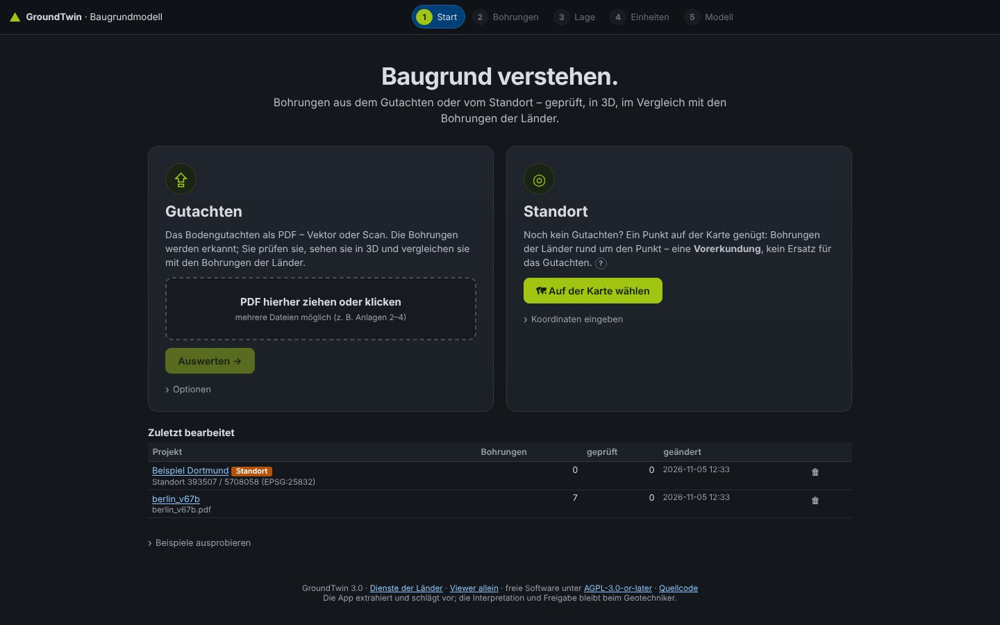
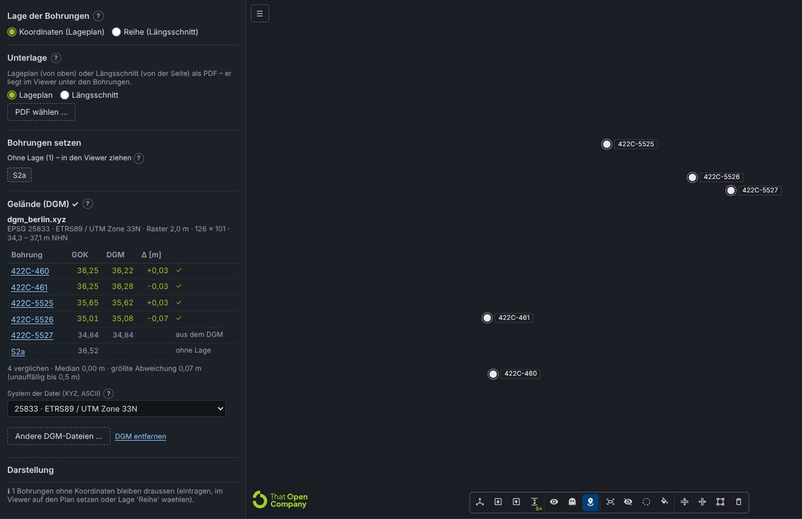
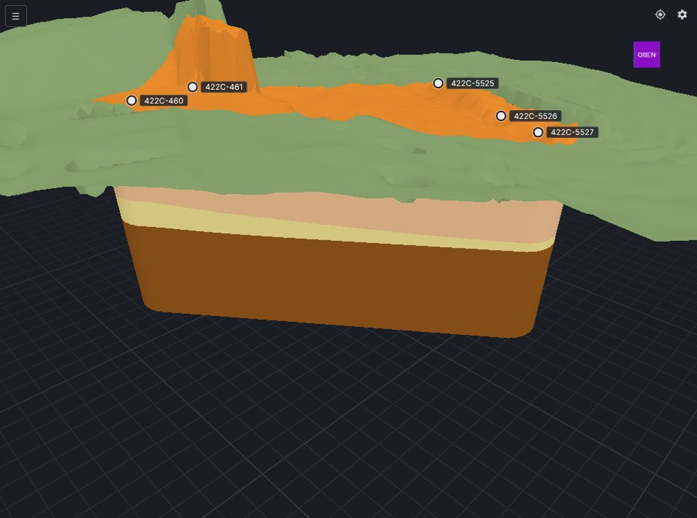
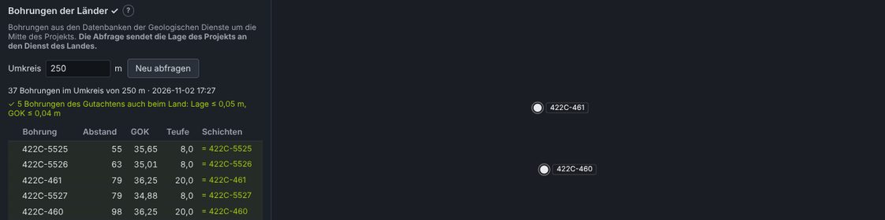
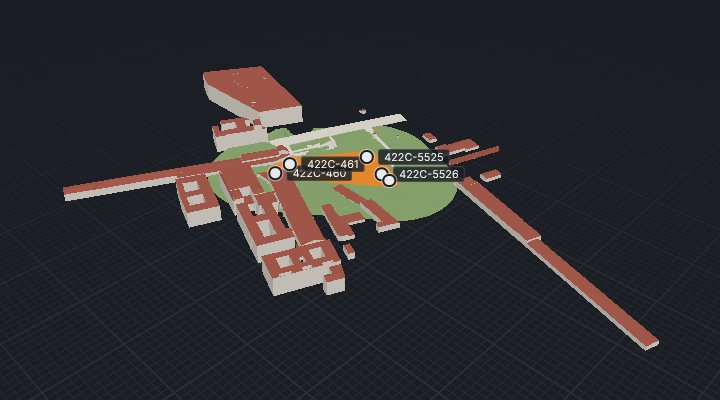
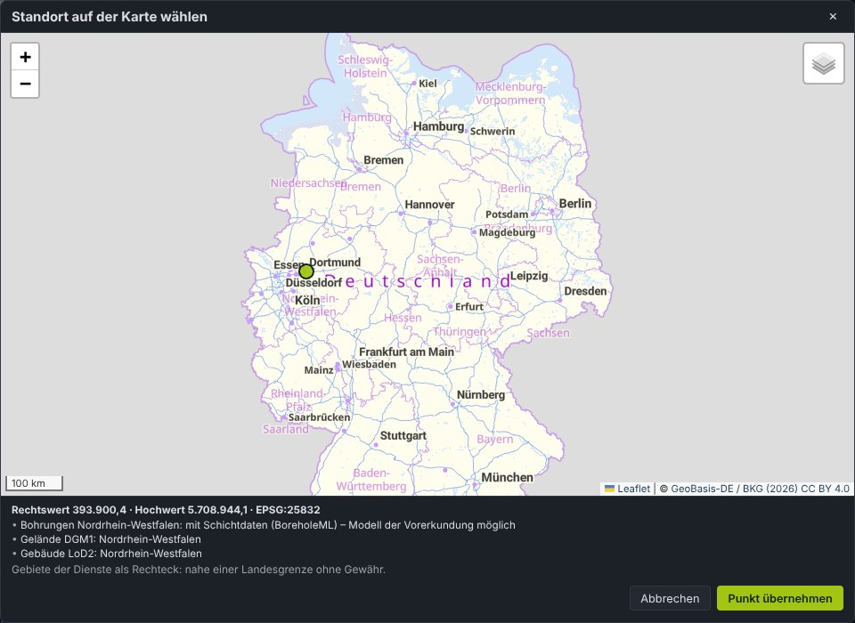
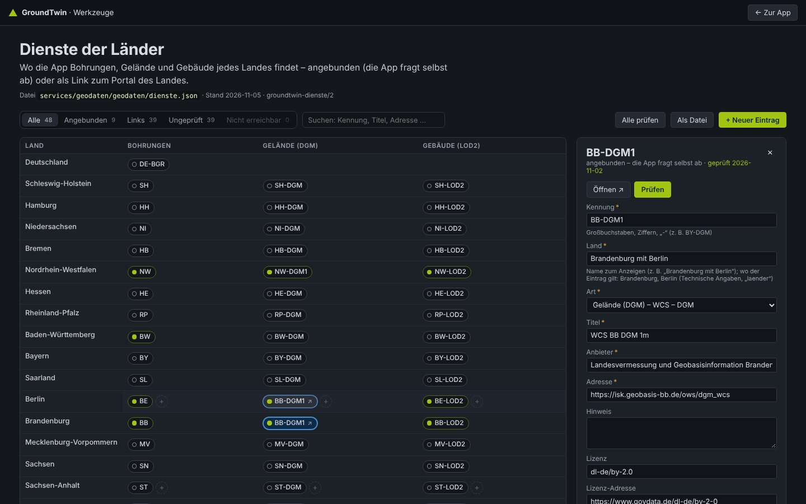
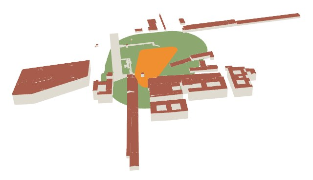
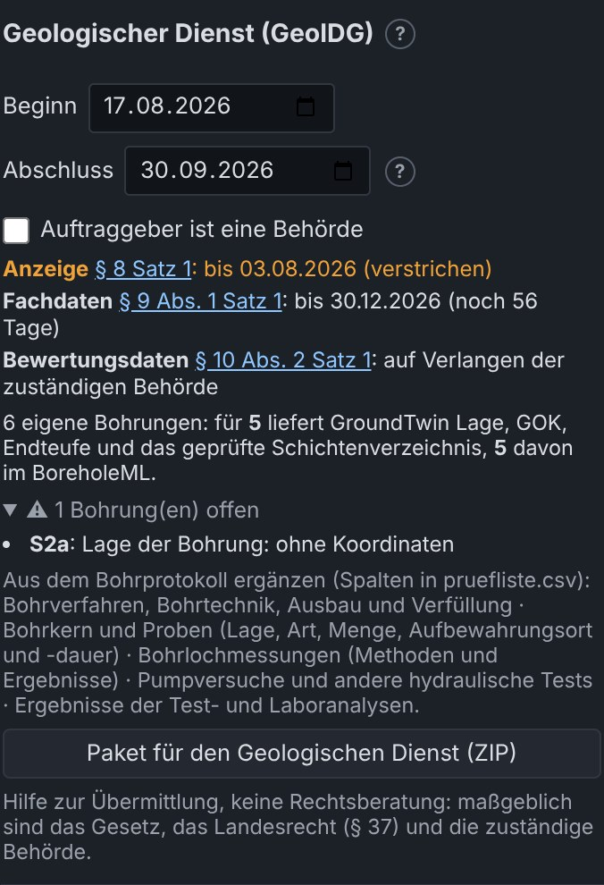

# 21 Step app, norms for the description and new calibration

The Baugrundmodell app leaves Streamlit: it is now a **full-screen step app** (FastAPI + a web page
with the integrated That Open viewer). Each step leads to the next and updates it:

**1 Start → 2 Bohrungen → 3 Lage → 4 Einheiten → 5 Modell.**

**Focus** (D99, feedback of a manager, 2026-11-05: "the UI is overloaded, too many functions"): the first use case is to
**show a Gutachten interactively and check it for plausibility, also against the Bohrungen of the Länder**. Every step
shows that first; DGM, buildings, display settings, model settings, further exports, Cesium, BoreholeML and GeolDG are
folded under **Erweitert** (§1.2). Nothing was removed: every function is one click away. The start page has two paths
of equal weight, a Gutachten (PDF) or a Standort (a point on the map) (§1.1).

In addition:

- **Warnings**: only for **unclassified** Schichten (`unklassifiziert`), not for confidence.
- **Norms**: a mini database with DIN 4023, DIN EN ISO 14688-1 and DIN 18196 reads every description.
- **New calibration**: measured distance, reference point and lock.
- **Diameter of the Bohrungen**: configurable.
- **IFC**: every Schicht carries its description and its interpretation by norm.

It replaces the Streamlit page of [19](19_app_v2.md) and the two-point calibration of
[20](20_lage_pruefung_viewer.md); the rest of 20 (TwinBimM controls, camera > 5 km, Prüfstand,
einchecken) stays the same.


## 1. Start-up and architecture

| Piece | What it does |
|---|---|
| [`start.bat`](../start.bat) / `python -m server` | Starts the app at <http://localhost:8500> and opens the browser (`--port`, `--arbeit <folder>`, `--kein-browser`) |
| [`server/api.py`](../server/api.py) | HTTP API (FastAPI) and the compiled page `apps/web/dist` on the same port: no Node needed |
| [`server/arbeitsplatz.py`](../server/arbeitsplatz.py) | Projects on disk, background extraction with progress, model cache, Unterlage, PDF pages |
| [`ui/projekt.py`](../ui/projekt.py) | Project state and **all the rules** (`aendern(op)`): corrections, warnings, removal, calibration, diameter |
| [`apps/web/src/app`](../apps/web/src/app) | The 5 steps (lit), help texts, SVG column |
| [`apps/web/src/viewer`](../apps/web/src/viewer) | The viewer as a module (`viewerStarten`), also standalone in `viewer.html` |
| [`start_excel.bat`](../start_excel.bat) / `streamlit run app.py` | Only the *Excel nach Vorlage* page (v1) |

Data in `ARBEIT` (`%TEMP%\geo_agent`, or `GEO_AGENT_ARBEIT` / `--arbeit`):

- `projekte/<signature>/docs.json`: the extraction, unchanged.
- `projekte/<signature>/projekt.json`: corrections, Lage, review, in the `geo_agent-projekt/2` format.
- `web/`: IFC, images of the plan and pages of the Gutachten.

A project saved by app v2 (`projekte/<signature>.json`) is picked up automatically when the same PDF
is opened.

The address `#/<project>/<step>/<Bohrung>` allows reloading or bookmarking without losing the place.

| API | |
|---|---|
| `GET /api/info`, `GET /api/projekte` | Version, OCR, examples; recent projects |
| `POST /api/gutachten` (PDF or extraction JSON), `GET /api/auftrag/<id>` | Background extraction with page x/y |
| `POST /api/beispiel` | Open an example |
| `GET /api/projekt/<signature>`, `POST …/aendern {ops}` | Full state; list of changes (all or nothing) |
| `GET …/bohrung/<id>`, `GET …/seite/<doc>/<page>` | Schichten with norm and proposal; page of the PDF (px per pt) |
| `POST/DELETE …/unterlage`, `POST …/unterlage/seite` | Plan or section as PDF, page and view |
| `POST …/modell`, `POST …/einchecken`, `GET …/export/<art>` | Model (cache by inputs), Prüfstand, downloads |

### 1.1 Start: two paths, Gutachten or Standort

The first step is called *Start* (it was *Gutachten*). Two cards of the same size, side by side:

| Path | In front | Folded (*Optionen*, *Koordinaten eingeben*) |
|---|---|---|
| **Gutachten** | Drop the PDF (or click), *Auswerten →* | OCR for scans; an extraction (JSON) or Bohrungen as BoreholeML (XML) can be loaded the same way |
| **Standort** | *🗺 Auf der Karte wählen*; after the click: the point, what the Länder deliver there (portals as links, *ungeprüft* marked), a free name and *Projekt am Standort anlegen →* | Rechtswert, Hochwert and the system typed by hand |

Below: *Zuletzt bearbeitet* (the five most recent projects; *Alle n Projekte* folded), *Beispiele ausprobieren*
(folded), and one line with the version, the tool *Dienste der Länder* (§4.8), *Viewer allein*, the license and the
source code (AGPL § 13).



### 1.2 What is in front and what is under *Erweitert*

| Step | In front (the use case) | Under *Erweitert* (one click, open when it holds data) |
|---|---|---|
| Bohrungen | Review and correct, the source in the PDF | – (unchanged) |
| Lage | One sentence on the state (*1 von 6 Bohrungen ohne Lage …* or *✓ Alle … haben eine Lage – jetzt mit den Bohrungen der Länder vergleichen*); Lage der Bohrungen, Unterlage, Kalibrieren, Bohrungen setzen (folded when, with the Lage by coordinates, every Bohrung has coordinates and there is no Unterlage; the Reihe stays open); **Vergleich mit Bohrungen der Länder** (open) | Gelände (DGM), Gebäude (LoD2), Darstellung (Ø of the columns); open as soon as a DGM or buildings are loaded |
| Einheiten | *Einheiten festlegen*, the Einheiten, the profile per Bohrung, the descriptions | Interpolation, Puffer, Raster, Basis, relative GOK, Gelände aus dem DGM; open as soon as one differs from the default |
| Modell | Key figures, Reifegrad, Prüfstand with einchecken, **IFC** and **Prüfbericht** | Further exports (Einheiten-Vorlage, Extraktion, Modell-Eingabe, Projektstand), 3D Tiles for Cesium, BoreholeML, GeolDG, Überhöhung; open when GeolDG dates are entered |

The open state stays while working (a re-render does not close what the user opened). The menu ⋯ links the tool
*Dienste der Länder*.

## 2. Bohrungen step: review and correct

- **Warning ⚠ = unclassified Schicht that has not been reviewed.** It goes away in three ways:
  choose the Bodenart, apply the *proposal by norm* or mark the Schicht as reviewed (a record remains
  that a person saw it). The extraction's confidence no longer generates warnings.
- **Stable navigation.** The selection lives in the address and the state; the neighbours are
  preloaded.
  - Keys: ↑/↓ (or J/K) to move between Bohrungen, **N** for the next open one, **G** to mark all
    Schichten as reviewed and move on.
  - The keys also work with the focus on a button; inside a field, typing is still typing.
  - The *Nächste offene* button works; the Streamlit problem was changing a `selectbox` that already
    existed.
- **Alle Bohrungen geprüft** marks all Schichten of all Bohrungen of the model; it can be undone.
- **Remove** (🗑 in the list or the button): the Bohrung leaves the model and stays under
  *Entfernt*, where it can be restored.
- **Source in the PDF.** Page of the Gutachten with the column of the Bohrung and the chosen Schicht
  marked, with zoom. In the examples that only bring the JSON, only the column is shown.
- **Fields of the Bohrung**: GOK, coordinates, EPSG, Ø of the column.

### 2.1 Plausibility report per Bohrung

[`ui/plausibilitaet.py`](../ui/plausibilitaet.py) (`pruefen(docs, p)`) checks the effective (user-corrected) values of
every Bohrung in the model and flags contradictions as a `warnung` or `hinweis` without ever modifying data
(`plausibilitaet` in `zustand()`). First task built by Antigravity from a hand-off
([24 §9](24_agent_team.md#9-phase-4-measured-results-2026-11-05)), reviewed and fixed by Claude:

- **Warnungen**: `reihenfolge` (Schichten not sorted by Oberkante or Unterkante ≤ Oberkante), `luecke` / `ueberlappung`
  (> 0.01 m between consecutive Schichten), `endteufe` (`end_depth` differs by > 0.1 m from the deepest corrected
  Unterkante), `grundwasser` (above GOK, depth < 0 m, or deeper than the Endteufe: the deeper of the stated
  Endteufe and the deepest Unterkante, so a missing bottom Schicht is reported once, by `endteufe`).
- **Hinweise**: `beginn` (first Schicht starts > 0.05 m below 0 m), `duenn` (Schicht thinner than 0.05 m), `gok_fehlt`
  (missing GOK: enter it in the table or take it from the DGM in the *Lage* step, `geodaten.gelaende`),
  `gok_nachbarn` (GOK deviates by > 3 m from the median of at least two neighbour Bohrungen within 200 m in the same
  EPSG).
- **UI** ([`schritt_bohrungen.ts`](../apps/web/src/app/schritt_bohrungen.ts)): summary line *Plausibilität: n
  Warnungen, m Hinweise* in the top bar, per-Bohrung badge with tooltip in the list, and expandable details on the
  selected Bohrung.

## 3. Mini database of norms

Files:

- [`normen.json`](../services/modeler/baugrundmodell/normen.json): the data.
- [`normen.py`](../services/modeler/baugrundmodell/normen.py): the reader.
- Tests: [`test_normen.py`](../services/modeler/tests/test_normen.py).

Each entry carries its **evidence**:

- `DIN4023`: confirmed in secondary sources.
- `praxis`: usual in the legends of Gutachten, but not confirmed in the text of the standard.
- `darstellung`: a colour chosen for display only.

The text of the standards is paid and was not read.

| Table | Content |
|---|---|
| Classes (those of the extraction) | DIN 4023 Kurzzeichen (G, S, U, T, X, Y, H, F, Mu, A, Mg, Lg, Lö, Löl), ISO 14688-1 symbol (Gr, Sa, Si, Cl, Co, Bo, Or, Mg), colour, fractions with grain size (fG 2–6.3 mm … gS 0.63–2 mm …) |
| Nebenanteile | g/fg/mg/gg, s/fs/ms/gs, u, t, x, y, h (humos), o (organisch); degrees `''` very weak, `'` schwach, — normal, `¯`/`*` stark, `=` sehr stark |
| State | Konsistenz (breiig/weich/steif/halbfest/fest; brg, wch, stf, hfst, fst), Lagerungsdichte (I_D, ISO 14688-2), Kalk (k0, k+, k++), Feuchte, Bodenfarbe (bn, gr, sw, we/ws, ro/rt, ge/gb, h/d) |
| DIN 18196 | GE … HZ, F, A, `[ ]` (Auffüllung of natural soil); **only if the text names it**, never estimated |
| Fels | Sst, Ust, Tst, Mst, Kst, Ko, Br; weathering (angewittert … zersetzt) |
| Ambiguities | `Mg` (Geschiebemergel in the old DIN 4023 / *made ground* in ISO), `Gr`, `H`, `Schotter` |

DIN 4023 colours, now also in the modeler, the IFC and the viewer:

| Class | Colour | In brackets: DIN 6164 |
|---|---|---|
| Kies | yellow | 2:6:1 |
| Sand | orange | 6:6:2 |
| Schluff | olive | 1:4:5; Grobschluff turquoise (2023) |
| Ton | violet | 14:5:4 |
| Torf/Humus | dark brown | – |
| Mudde | lilac | 11:4:4 |
| Mutterboden | yellowish brown | 4:5:3 |
| Auffüllung | no colour in the standard; grey for display | – |

The 2023 edition of the standard only names the colours, without the DIN 6164 number.

**Reading** (`deuten`). It works the same for written text ("Schluff, stark tonig, kiesig,
weich-steif, TA") and for abbreviations ("mS, fs', u").

Preparing the text:

- Apostrophes and overlines unified.
- The decimal comma ("770,17 mNN") does not split the text.
- Words glued together by the PDF are separated ("FeinsandbisMittelsand", "schwachhumos",
  "MittelsandFeinkies").

Choosing the main component:

- The first noun or Kurzzeichen is the main one.
- *Auffüllung* or *Mutterboden* + soil gives a material ("Auffüllung (Schluff, stark tonig)").
- A geological name + soil does too ("Geschiebemergel (Schluff, sandig, kiesig)").
- Nouns of the same type form a range ("Fein- bis Mittelsand"); of another type, a Nebenanteil
  without a degree (`fg(?)`).

Output:

- Benennung and Kurzzeichen DIN 4023 / ISO.
- Bodengruppe, consistency, density, lime, moisture, colour.
- Inclusions and foreign materials.

**What is doubtful is marked**:

- `Mg` on its own is treated as ambiguous.
- `Lehm` is an uncertain proposal.
- An OCR error at distance 1 ("Grobaand" → Grobsand) is accepted as uncertain.
- Foreign materials give the warning "Auffüllung prüfen".
- A group that does not match the main component is flagged ("TL" in a Kies).
- If it differs from the extraction, it is flagged ("Extraktion: Sand, nach Norm gelesen:
  Auffuellung").

A **proposal** for an unclassified Schicht is only applied with a click, and it stays marked as
corrected.

| Example | Schichten | Read | Contradict the extraction |
|---|---|---|---|
| Talheim | 65 | 63 (2 without text) | 0 |
| Berlin | 69 | 66 (3 without text; 2 "Grobaand" uncertain) | **13**: the text says *Auffüllung* (of sand), the extraction put "Sand" |
| Demo / Trasse | 57 / 127 | all | 0 |

The 13 cases in Berlin are a real finding: according to DIN 4023 they are fills, not natural sand.
They stay marked, not changed (lesson B4).

## 4. Lage: new calibration

Steps in the left panel; the viewer stays on the right:

1. **Unterlage**: Lageplan or Längsschnitt as PDF, with page, view and opacity.
2. **Maßstab**:
   - *Strecke messen*: two clicks on the plan (graphic scale, a dimension, two Bohrungen) and the real
     length in m.
   - Or *1:n*, with the paper size of the image.
   - In the section, the **vertical scale** can be the same, `1:n` or measured (Überhöhung).
3. **Bezugspunkt**: a click on a known point and its coordinate (Rechts-/Hochwert, or Station/NHN in
   the section). It can be copied from a Bohrung with coordinates.
4. **Drehung** (plan): degrees against grid north, positive anticlockwise. The **coordinate system
   (EPSG)** is chosen from a list next to the reference point (§4.2).
5. **🔒 Übernehmen und sperren**. The plan is fixed and does not move any more.

How the Bohrungen move:

- Before locking, the Bohrungen cannot be dragged.
- Afterwards, on the plan they only move in **x/y**.
- In the section they move along the **station**. In **height** only if the PDF has **no GOK**; the
  server also rejects a `gok` event in that case.

While typing, the preview moves the plan; marks 1, 2 and B are only visible during the calibration.
If the plan jumps far away (when typing its Rechts-/Hochwert), the camera follows it and it does not
disappear from view.

Formulas (the same in [`ui/projekt.bild_zu_welt`](../ui/projekt.py) and in `lage.ts/abbildung`):

```
s = metres / |p2 − p1|   or   n · mm_per_px / 1000          (m per px)
plan:    (x, y) = (x0, y0) + R(−θ) · s · (u − u0, −(v − v0))
section: station = x0 + s·(u − u0),  NHN = y0 − s_h·(v − v0)
```

An old two-point calibration is converted on loading into exactly the same transformation (tested).

**Ø of the columns**:

- Per project and per Bohrung.
- Automatic: `clamp(extent/300, 0.8, 12)` m. It is a display value, so that they are visible on a
  6 km Trasse.
- Applied the same way in the viewer and in the IFC (`CPset_Darstellung.Durchmesser_m` and its
  origin).


Results with the synthetic plans of [`scripts/testplan.py`](../scripts/testplan.py):

| Case | Result |
|---|---|
| Plan 1:500 rotated by 10°, calibrated from the UI (distance B 1–B 4 + B 1 as reference + 10°) | **1:500 · 10.0°** |
| Marks on the circles of the plan | 0.3 px |
| B 6 and BS 9 dragged from the list | 0.06–0.08 m |
| Section 1:500/1:100: stations | ≤ 0.02 m |
| Section: GOK from the PDF | unchanged |

### 4.1 No Bohrung with coordinates (real case: RKS without a position)

User report: after locking the plan the Bohrungen could not be dragged and the plan flickered (also
when transparent); the viewer turned black. Reproduced with [`testplan.py`](../scripts/testplan.py)
(`plan_ohne_lage_extraktion.json`: the test plan without a single coordinate). Causes and fixes:

| Symptom | Cause | Fix |
|---|---|---|
| Flicker | In `RendererMode.MANUAL` That Open draws every frame without postproduction and 50 ms later with it; the viewer requested a frame on every mouse move and every second | The viewer decides the postproduction (D73, M29): never in *Lage*; in the model only at rest; no redraw just for moving the mouse |
| Black viewer | The GTAO pass kept computing with perspective formulas in the orthographic view (and a negative `near`) | `PERSPECTIVE_CAMERA` follows the projection (M30) |
| Bohrungen "do not drag" | The first dropped Bohrung moved the project origin by ~6000 km (from the stations of the *Reihe* to the plan) and the camera was left looking into the void | Origin from the reference point of the plan when calibrating it; the camera follows any change of origin (D74, M31) |
| Dragging blocked | A pending "Punkt im Plan wählen" blocked all dragging | It is cancelled when locking and when dragging (M32) |
| Empty preview | When the Rechts-/Hochwert was typed, the plan jumped out of view | The camera follows large jumps of the plan; vertices relative to its corner (Float32 precision) |

The same script against the previous version (`3005cb9`) and the new one:

| | Previous | New |
|---|---|---|
| Preview after typing the coordinate | plan out of view | in view |
| Origin after locking | (100, 0) | (565,000, 5,933,000) |
| Frames at rest (3 s) / when moving the mouse | 12 alternating E/P / 80, 20 with postproduction | no alternation / 0 with postproduction |
| B 1, B 7, BS 10 from the list | B 1 placed, then plan and marks out of view; B 7 and BS 10 not placed | all three at 0.35–0.45 m, plan always in view |

In addition, in *Lage* the left button **pans** the plan (That Open's *Plan* navigation) instead of
rotating the view (D76).

Second report: *"I could drag some GWM but not BH"*. The test data had elevations of ~38 m NHN, which
hid it; with real elevations (`plan_ohne_lage_extraktion.json` now with GOK + 300 m and the BS without
a GOK, like GWM) and the app opened directly at `#/<project>/lage`, three causes appeared (D78):

| Symptom | Cause | Fix |
|---|---|---|
| BH with a GOK do not drag; GWM without a GOK do | In the orthographic view three.js starts the mouse ray at the camera plane. Without placed Bohrungen the plan was drawn at 10 m NHN and the camera 200 m above it; with the ×5 exaggeration the GOK of a BH (≈ 340 m NHN → +1700 m in the scene) lay **above** the camera and the ray never hit it; a GWM without a GOK (0 m) lay below | Ray from the `near` edge ([`kamera.strahl`](../apps/web/src/viewer/kamera.ts), M34); the plan is drawn above the highest known GOK |
| Plan rotated by 180° (calibration with «Drehung 180»), clicks that miss | When switching to orthographic with the camera not yet placed, That Open computes a **negative** width/height (and scales it with the first size of the viewer): inverted frame and zoom stuck at the minimum | Frame always positive at the viewer's aspect (`orthoRichten`, M35); minimum zoom 1e-4 |

With the previous version (`a6c1511`) and that data the plan was not even visible after uploading it
(inverted, tiny frame) and the calibration clicks failed. With the fix, in the end-to-end test: B 1 and
B 7 (GOK 338 m) and BS 10 (without a GOK) dragged to within 0.29–0.36 m.

### 4.3 Points: place, assign to a Bohrung and delete

Besides dragging, **points** can now be placed (user request), only with the Lageplan calibrated and
locked:

1. **＋ Punkte im Plan setzen** switches the mode on (crosshair cursor; Esc or *Fertig* ends it).
2. *Nächster Klick setzt*: the Bohrung that gets the next click. By default the first one without a
   position; after each click it moves on to the next one without a position. A click on a chip in
   *Ohne Lage* selects it.
3. With *– freien Punkt –* the click leaves a **free point ◆ P1, P2 …** (yellow) that is assigned
   later in the list.
4. **Gesetzte Punkte**: every Bohrung placed on the plan and every free point, with its coordinates, a
   dropdown (assign the free point; move the position to another Bohrung, or *Zuordnung lösen*, which
   turns it into a free point) and **✕** (delete the point; for a Bohrung, remove its position: it goes
   back to *Ohne Lage* or to the coordinates from the PDF).
5. In the viewer: clicking a mark and pressing **Del** does the same as ✕. Panning the plan does not
   place points (5 px threshold).

Server operations ([`ui/projekt.py`](../ui/projekt.py)): `punkt` (with or without `bohrung`),
`punkt_zuordnen`, `punkt_loeschen`, `lage_entfernen`, `lage_loesen`, `lage_umhaengen`. Free points are
saved with the project (`punkte`); an assigned position is that of the Bohrung (`Plan (kalibriert)`,
with the EPSG of the plan).


### 4.2 Coordinate system (EPSG)

A list instead of a free number, in the calibration panel and in the *Bohrungen* step (per Bohrung).
Codes and names verified with the EPSG database of pyproj 3.8 ([`epsg.ts`](../apps/web/src/app/epsg.ts)):

| Group | Systems |
|---|---|
| Germany · ETRS89/UTM | 25832 (UTM 32N), 25833 (UTM 33N), 4647 (32N with prefix 32…), 5650 (33N with prefix 33…) |
| Germany · Gauß-Krüger | 31466–31469 (DHDN, zones 2–5), 2398/2399 (Krassowski 42/83, zones 4/5) |
| Germany · others | 3068 (Soldner Berlin) |
| Switzerland | 2056 (LV95), 21781 (LV03) |
| Austria | 31254–31256 (GK West/Central/East), 31257–31259 (BMN M28/M31/M34) |
| GPS | 32632, 32633 (WGS 84 / UTM) |

Each system carries its **range of Rechts-/Hochwert** (area of use in DACH, GK strips ±1°, rounded to
10 km). When a coordinate is typed, a warning appears if it does not fit, with the systems that would;
it never blocks (D75). Examples: 565,000 / 5,933,000 → ✓ 25832; 4,468,000 / 5,333,000 with 25832 →
"fits 31468"; 74,848.90 / 5,603,772.65 (the value in the user's screenshot) → "fits no system, check
the digits". An unknown code coming from the PDF is shown marked (⚠), not lost. Without an EPSG on the
Bohrungen, the viewer uses the plan's.

### 4.4 Gelände (DGM): GOK check, DGM from the Land, terrain in the model

Phases P3a and P3b of the open data plan ([23](23_open_data_integration.md), D89, D92).

**Loading:**

- The user downloads the DGM tiles of the site from their Land (open data, usually DGM1) and loads
  them in the *Lage* step, section *Gelände (DGM)*.
- Formats: XYZ, ASCII grid or GeoTIFF, several tiles at once, also as ZIP.
- XYZ and ASCII carry no coordinate system: the list offers the project's one
  ([`services/geodaten`](../services/geodaten/README.md)).
- Files are read without network, so nothing reveals the site of a confidential project.

**DGM vom Land** (P3b, D92):

- *DGM vom Land abrufen* fetches the DGM1 of the cut-out around the Bohrungen (plus a margin, 100 m by
  default) from the WCS of the Land ([`dienste.json`](../services/geodaten/geodaten/dienste.json)):
  - Brandenburg with Berlin (LGB, dl-de/by-2.0).
  - NRW (Geobasis NRW, dl-de/zero-2.0).
- **Only on a click**: the button says that the cut-out is sent to the service.
- Source, license and attribution stay with the DGM and go into the IFC.
- A cut-out of more than 3 km per side comes with a coarser grid (2 m and up).
- Not offered, load the DGM1 tiles as files:
  - Baden-Württemberg: its WCS delivers whole metres.
  - Bayern: no free WCS.
- Berlin example: 2.4 s for 340 × 331 m.
  - 422C-460, -461 and -5525 lie within 0.45 m of the DGM.
  - 422C-5526 and -5527 lie 1.0 and 1.1 m below today's terrain and are marked.

**The comparison table** has one row per Bohrung: GOK, DGM height, Δ and a status (✓, *weicht ab*,
*GOK fehlt*, *aus dem DGM*, *außerhalb*, *ohne Lage*, *anderes EPSG*).

- |Δ| up to 0.5 m is unremarkable (DGM1 ± 0.2 m, plus vegetation and excavation).
- **If all Bohrungen lie about the same amount above or below the terrain** (median > 1 m, ≥ 80 %
  with the same sign), a warning names the likely causes: Lage (EPSG, calibration) or height
  reference (local height instead of NHN). It is an independent check of the calibration.
- Bohrungen outside the DGM, or in another EPSG, are listed rather than compared.

**A missing GOK** gets the DGM height as a **proposal**.

- It is applied only with *übernehmen* (one Bohrung) or *Alle … übernehmen*.
- It is marked as source **DGM** in the table, in the viewer, and in the IFC
  (`CPset_Herkunft.Hoehe = "aus dem DGM (m NHN)"`).
- Typing a value afterwards makes it *manuell*.
- A GOK from the PDF is never replaced.
- Removing the DGM keeps the GOK already taken from it.



**Gelände im Modell** (P3b, D92): setting *Gelände aus dem DGM* in the *Einheiten* step, on by default
when a DGM is loaded.

- **The top of the model follows the DGM** instead of an interpolation between the GOK of the
  Bohrungen.
- **At each Bohrung it stays exactly on the GOK.** The difference GOK − DGM fades out with the
  distance to the Bohrung, so the model joins the DGM at its edge. Reach: half the spacing of the
  Bohrungen, at least two mesh cells, at most 25 m. Contacts stay exact and solids stay closed
  ([18 §3](18_layer_modeler.md#3-surfaces-and-solids)).
- **A note marks the unexplored ground.** Where the DGM lies more than 1 m above or below the
  interpolation of the GOK (an embankment, a hollow, an excavation), the top Einheit was not
  explored. Berlin example: a mound up to 5.6 m above, 11 m north of 422C-461.
- **Fallback with a note:** the top comes from the GOK as before when any of these holds:
  - The DGM does not cover the model area.
  - The DGM is in another EPSG.
  - A Bohrung has a schematic Lage or a relative height.
- **IFC:** the terrain around the model is an `IfcGeographicElement` TERRAIN.
  - It reaches 100 m out, at most to the edge of the DGM.
  - It is an open triangulated surface that shares the edge nodes of the model: no gap and no double
    surface.
  - `CPset_Gelaende` holds source, license, attribution and date; `CPset_Baugrundmodell.Gelaende`
    names the source of the top.
- **Viewer:** the *Gelände* button shows or hides the terrain.



### 4.5 Bohrungen der Länder: existing boreholes around the site

Phase P2 of the open data plan ([23](23_open_data_integration.md), D85, D88, D91).

**Querying:**

- Section *Bohrungen der Länder* in the *Lage* step. *Abfragen* asks the services of the state geological
  surveys for the Bohrungen within the radius (250 m by default) around the middle of the project.
- The registry with evidence is [`dienste.json`](../services/geodaten/geodaten/dienste.json), maintained with the
  tool *Dienste der Länder* (§4.8). **All 16 Länder** are in it:
  - Berlin and Brandenburg: header data, with the Schichtenverzeichnis as an image.
  - NRW and Baden-Württemberg: BoreholeML with the released Schichtdaten.
  - The other 12 have no public data service with Schichtdaten: their portal (viewer, download or request) is a
    **link**, marked *ungeprüft* (entered, not tested against the service), plus the Bohrpunktkarte of the BGR for all
    of Germany.
- **Which Land:** from the borders of the Länder (VG2500 of the BKG, `geodaten/laender.py`), no longer from the
  rectangles of the services, which overlap (Berlin asked Brandenburg too; a click in Saxony-Anhalt named Brandenburg).
  The query looks at the centre and eight points on the radius: at a border **both** Länder are asked (lesson S20).
- **Nothing is sent without the click**: the button text says that the query sends the location of the
  project to the service.

**The list:**

- Name, distance, GOK, Endteufe, and the Schichten: *n Schichten*, *Profil ↗* or *keine*.
- The sources and licenses: Berlin dl-de/zero-2.0, Brandenburg and NRW dl-de/by-2.0 with the required
  attribution.

**Gegenprobe:**

- A Bohrung of the Gutachten that the Land also has (same name within 50 m, or closer than 3 m) is
  marked = *code*, with the difference in Lage and GOK. This is an independent check of the calibration,
  like the DGM.
- With the Berlin example, all five georeferenced Bohrungen are found: Lage ≤ 0.05 m, GOK identical.

**Übernehmen:** only Bohrungen with Schichtdaten in BoreholeML.

- **Why the others cannot be taken over, said in the list** (line *Nicht übernehmbar*, counted per Land):
  - Berlin and Brandenburg give the Schichtenverzeichnis only as an **image** (*Profil ↗*), not as data. Without
    Schichten no model can be built, and inventing them would be wrong (a doubtful value is marked, never invented).
    Lage, GOK and Teufe are in the list; the Schichten are in the profile of the Land.
  - Bohrungen without a Schichtenverzeichnis, and Schichten without petrography (often Baden-Württemberg), are
    counted the same way.
  - Before, the explanation only appeared when at least one Bohrung could be taken over: in Berlin the list showed
    38 rows and no reason (user report 2026-11-04).

- They come into the project as a further document (`fremd.json`; the project keeps its signature), in the system of
  the project: a Gutachten with the zone prefix (EPSG 4647/5650) gets them with the prefix, and the Gegenprobe compares
  in one system (lesson S17).
- Where a Land has no data service (for example Bayern), the query names its portal and the Bohrpunktkarte of the BGR
  as links (*Kein Datendienst für Bayern – die Bohrungen im Portal ansehen*), instead of showing 0 Bohrungen; at a
  border, only for the Land without a service. Only when neither a service nor a portal exists does it say *kein Dienst
  für diesen Ort* (with the connected Länder).
- Their codes carry the Land (`NW-14`).
- Each one carries source, ID, license and date: *aus … – nicht aus dem Gutachten*.
- They appear as a rhombus in the viewer, are reviewed like the others, and are modelled.
- They are **never** exported back as BoreholeML.
- *Zurücksetzen* removes them.

**Connection to the services** (also DGM and Gebäude):

- TLS is checked against the root certificates of the system **and** of Mozilla (certifi). Windows holds a new root
  only after a browser needed it, so Berlin failed on a PC with `CERTIFICATE_VERIFY_FAILED` (lesson X33).
- A failed service shows why: certificate, HTTP status or timeout. A certificate error is not retried.
- `.venv\Scripts\python scripts\dienste_pruefen.py` (Windows) checks every service of `dienste.json` from this
  computer and prints one line per service. It sends no Lage of a project.



### 4.6 Gebäude (LoD2): buildings around the site

Phase P4 of the open data plan ([23](23_open_data_integration.md), D86, D93): the Umgebungsmodell with
the terrain of §4.4.

**Fetching:**

- Section *Gebäude (LoD2)* in the *Lage* step. *Gebäude vom Land abrufen* loads the 3D building models
  LoD2 of the Land for the cut-out around the Bohrungen (plus a margin, 100 m by default).
- Berlin, Brandenburg and NRW publish them in the same way: CityGML tiles of 1 × 1 km in the AdV profile,
  in ETRS89/UTM with heights in DHHN2016. That is the frame of the model, so no quasigeoid and no
  meridian convergence are needed ([`dienste.json`](../services/geodaten/geodaten/dienste.json)).
  - Berlin: dl-de/zero-2.0.
  - Brandenburg: dl-de/by-2.0.
  - NRW: dl-de/zero-2.0.
- **Only on a click.** The tile numbers reveal the site to about 1 km.
- Each tile comes from the first service that has it, the Land of the centre first. Which services: the Länder of the
  cut-out (centre and eight points at half its diagonal, §4.8): in Berlin only Berlin, at the border Berlin and
  Brandenburg.
- A dropped connection is retried, up to three attempts.
- Berlin example: 2 tiles, 39 buildings and 2,463 faces in about 11 s.

**In the model:**

- **Selection:** a building counts when its footprint touches the cut-out. It is taken whole, not clipped.
- **Faces:** walls, roof and ground are read, with openings. The virtual closure surfaces are left out.
- **IFC:** one `IfcBuildingElementProxy` per building (`USERDEFINED`, "LoD2-Gebäude (Umgebung)").
  - Its geometry is two open `IfcPolygonalFaceSet`: walls and ground in light grey, the roof in tile red.
  - Faces with openings are `IfcIndexedPolygonalFaceWithVoids`.
  - `CPset_Gebaeude` holds source, license and attribution of its own service, the GML id, function,
    roof type and height.
- **Viewer:** the *Gebäude* button shows or hides them.
- **Removing:** *Gebäude entfernen* takes them out of the next IFC.

**Heights in place:**

- In the AdV profile, the ground of a building is the lowest point of the DGM at its footprint.
- Measured against the DGM1 of the Land, with a median of 0.00 m in both places:
  - Berlin: 97 % of the buildings within 0.5 m.
  - Marl (NRW): 100 % within 0.5 m.
- The mean of the DGM at the footprint differs by metres on slopes: a flat ground plate on sloping terrain.



### 4.7 Standort ohne Gutachten: a Vorerkundung from a point

Phase P5 of the open data plan ([23 §2.3](23_open_data_integration.md#23-a-baugrundmodell-from-a-point-standort-start),
D85, D94): a first Baugrundmodell before there is a Gutachten, built only from the Bohrungen of the Länder.

**Starting:**

- Card *Standort* on the start page (§1.1): *Auf der Karte wählen*, or Rechtswert, Hochwert and the system typed
  under *Koordinaten eingeben* (ETRS89/UTM 32N or 33N, also with the zone prefix: 25832, 25833, 4647, 5650), a free
  name, *Projekt am Standort anlegen →*.
- **Or on the map** (D97): *🗺 Auf der Karte wählen* opens a pop-up with a map, only to find the place; a click sets
  the point.
  - Background: basemap.de Web Raster of the BKG (official, „© GeoBasis-DE / BKG (2026) CC BY 4.0“) or
    OpenStreetMap, switchable. Leaflet (BSD-2-Clause) and the tiles load only when the pop-up opens; the map area then
    goes to that server (the help says so).
  - The server converts the click (longitude/latitude) to ETRS89/UTM: zone 32 west of 12° east, otherwise 33
    (`geodaten/utm.von_geo`, Krüger series, below 1 mm against PROJ). The map is in WGS84, about 1 m from ETRS89:
    enough to place a Vorerkundung.
  - Below the point it says what the services of the Länder deliver there (`bohrdaten.am_ort`), before the project
    exists: for example *Bohrungen Nordrhein-Westfalen: mit Schichtdaten (BoreholeML)* or *Bohrungen Berlin: nur
    Kopfdaten, Schichtenverzeichnis als Bild – nicht ins Modell*. A Land without a data service shows its portal as a
    link, marked *ungeprüft* (§4.8). The Land comes from the borders of the Länder (VG2500), not from the rectangles of
    the services.
  - *Punkt übernehmen* fills Rechtswert, Hochwert and the system; typing another value clears the list.



- The point is checked: only ETRS89/UTM zone 32 or 33, and it must lie in Germany (a rectangle of 5.5–15.5° east,
  47.2–55.1° north). Gauß-Krüger or a typo of one digit gives a message, not a project. The ranges of the UTM values
  alone were not enough: a point in Paris in zone 31 has numbers in the same range and was accepted (lesson S18).
- **Examples** (*Beispiele ausprobieren → Standort*), checked against the real services within 250 m; the query
  stays a click in the *Lage* step (network):

  | Example | What the Land delivers |
  |---|---|
  | Dortmund (NRW), 393507 / 5708058 (EPSG:25832) | 24 Bohrungen with Schichtdaten, 143 Schichten, 1 unklassifiziert: a model with 15 Einheiten in about 30 s |
  | Karlsruhe (Baden-Württemberg), 456391 / 5428394 (EPSG:25832) | 15 Bohrungen, 10 with Schichtdaten; 66 of 112 Schichten without petrography (unklassifiziert, marked) |
  | Berlin-Friedrichshain, 394800 / 5818400 (EPSG:25833) | 38 Bohrungen with header data and the profile as an image: terrain and buildings, no layer model |

- The project is an empty document *Standort x / y (EPSG)*. The same point opens the same project again, at its
  step and with its name (a message says so); it is not renamed.
- *Alle Korrekturen verwerfen* (menu) keeps the name and returns to the *Lage* step. Like for every project, it also
  removes the imported Bohrungen der Länder, the query, the DGM and the buildings; the dialog says so.
- A point with the zone prefix (EPSG 4647 or 5650, often in NRW) stays in that form: the Bohrungen of the Länder, which
  come without the prefix, are imported into it (lesson S17).
- It opens in the *Lage* step with the Lage by coordinates, **without the Lageplan sections** (*Lage der Bohrungen*,
  *Unterlage*, *Kalibrieren*, *Bohrungen setzen*): the point is already georeferenced, and the Bohrungen of the Länder
  come with their coordinates, so nothing is georeferenced twice. A section *Standort* shows the point and the services
  there; *Bohrungen der Länder* comes first and open. A Gutachten added later becomes a new project with a Lageplan.
- The point is:
  - the centre of every query: Bohrungen der Länder (§4.5), DGM (§4.4) and Gebäude (§4.6);
  - the origin of the scene, rounded to 100 m. The imported Bohrungen come in around it, so the origin does not
    jump and the plan shows all of them at once.
- The project list marks it as *Standort*. It counts the imported Bohrungen of the Länder with the others.

**Bohrungen:**

- Only services with Schichtdaten give a model: NRW and Baden-Württemberg (BoreholeML).
- Berlin and Brandenburg publish only the header and a profile image. A Standort there gets DGM and buildings,
  but no model (§4.5).
- The Schichten of an archive Bohrung get a fixed confidence of 0.5. In the Prüfstand they are reviewed like the
  others; with no PDF behind them, a tick means "accepted", and the Reifegrad keeps that visible.

**Reifegrad (maturity), marked everywhere:**

- From the origin of the Bohrungen in the model: **Gutachten** (only from PDFs), **Vorerkundung** (only Bohrungen
  of the Länder or BoreholeML files) or **gemischt**.
- App: badge in the header and a banner in the *Modell* step.
- Viewer: a band at the top, taken from the IFC.
- Report: `reifegrad` and a hint ("Vorerkundung: … Schichten nicht gegen ein PDF geprüft").
- IFC: `CPset_Baugrundmodell.Reifegrad` and `Herkunft_Bohrungen` (count per origin). Every Bohrung carries
  `CPset_Herkunft` with *Herkunft*, *Datenquelle*, *Lizenz* and *Abgerufen*.

**A Gutachten later:**

- With a Standort project open, the *Start* step says that the PDF goes to this Standort.
- The PDF becomes a **new** project that takes over:
  - the Bohrungen der Länder with their Prüfstand (their keys move behind the Gutachten);
  - the query, with the Gegenprobe recomputed against the Bohrungen of the Gutachten (no network);
  - the DGM and the buildings.
- Both sources stay apart: Gutachten codes next to `NW-…`, *Herkunft* per Bohrung, Reifegrad *gemischt*. The Standort
  project stays as it was.
- If the Gutachten writes its coordinates in the other form of the same zone (with or without the prefix), the
  Bohrungen of the Länder, the DGM and the buildings are moved into its system.

**Measured in Marl (NRW, real service):**

- A point at 368300 / 5724500 (EPSG:25832): 11 Bohrungen within 250 m, all with Schichtdaten.
- Query 7 s, import 7 s, model 1 s: **15 s** from the point to a model with 15 Einheiten.
- The end-to-end check (F) does the same at 368130 / 5724400 with 10 Bohrungen and checks the Reifegrad in the
  header, the report, the *Modell* step and the viewer.

**Limits (marked):**

- Archive Bohrungen are often old, very deep (water wells) or very shallow, and their quality is unknown.
- There are no Sondierungen and no soil parameters.
- Einheiten correlated across hundreds of metres can invent continuity.
- In Marl, 10 Schichten stay unklassifiziert (warning in the *Bohrungen* step).
- Not built yet: a map of the distance to the nearest Bohrung in the viewer
  ([23 §2.3](23_open_data_integration.md#23-a-baugrundmodell-from-a-point-standort-start)). Per Einheit, the IFC
  already carries the maximum distance to a Bohrung (`CPset_Modelleinheit`).


### 4.8 Dienste der Länder: one file, one tool

Decision D98. Where the app finds the Bohrungen, the terrain and the buildings of each Land is **one file**,
[`services/geodaten/geodaten/dienste.json`](../services/geodaten/geodaten/dienste.json) (format
`groundtwin-dienste/2`), and **one tool** to maintain it: the page `dienste.html` (link at the bottom of the start page
and in the menu ⋯).

**An entry:** `id`, `land` (the name shown, for example *Brandenburg mit Berlin*), `laender` (where it applies: names
of the 16 Länder; derived from the Land when missing), `art`, `status` (`geprueft` with the date in `geprueft`, or
`ungeprueft`), `aktiv` (`false` = not used by the app), `titel`, `anbieter`, `url`, `hinweis`, `lizenz`, `lizenz_url`,
`namensnennung` (`{jahr}` is replaced at the fetch), `beleg` (where it says so), and the technical fields of its art:

| Art | Theme | What the app does | Required besides id, land, titel, anbieter, url |
|---|---|---|---|
| `wfs-kopf` | Bohrungen | queries the header data (Berlin, Brandenburg) | `typen`, `systeme`, `felder` |
| `wfs-boreholeml` | Bohrungen | queries BoreholeML with Schichtdaten (NRW, Baden-Württemberg) | `typen`, `systeme` |
| `wcs-dgm` | Gelände | fetches the DGM cut-out (Brandenburg with Berlin, NRW) | `coverage`, `achsen`, `system`, `raster_m` |
| `lod2-kacheln` | Gebäude | fetches the CityGML tiles (Berlin, Brandenburg, NRW) | `system`, `format`, `kachel_km`; the address with `{e}` and `{n}` |
| `portal-bohrungen`, `portal-dgm`, `portal-gebaeude` | each | only a link (view, download or request) | – |

Now 48 entries: the 9 connected services (*geprüft* 2026-11-02/03) and 39 links (*ungeprüft*): the Bohrungen portals
of the 12 Länder without a data service, the Bohrpunktkarte of the BGR for Germany, and the DGM and LoD2 portals of the
13 Länder without a connected service. The links were entered from the official websites and **not tested**: the
user asked to add all Länder fast, without tests (2026-11-05). The tool tests them on a click.

**The tool:**

- A table Land × theme (Bohrungen, Gelände, Gebäude) with one chip per entry: filled dot = connected, ring = link,
  green border = geprüft, ↗ = a service of the neighbouring Land that applies here (BB-DGM1 in Berlin), struck through =
  off. Filters *Alle · Angebunden · Links · Ungeprüft · Nicht erreichbar* and a search.
- A click opens the entry on the right: the fields (required ones marked), *Technische Angaben* as JSON, *Öffnen ↗*,
  *Prüfen*, *Als geprüft markieren* (after a successful check, with today's date), *Eintrag entfernen*. *+ Neuer
  Eintrag*, or the + in a cell (the Land and the theme are filled in).
- *Prüfen* asks the real service once: WFS or WCS `GetCapabilities` (are the entered types or the coverage there?), the
  tile in the middle of the area, or the portal page (the first 2 KB). *Alle prüfen* checks the visible entries, four
  at a time.
- Changes stay on the page until *Speichern* (a floating bar: *Änderungen nicht gespeichert · Verwerfen · Speichern*).
  The server checks every entry (id, required fields of the art, https, `{e}`/`{n}`, known Länder, area, status,
  date), completes it (Länder from the Land, area from the borders, status *ungeprueft*), orders keys and entries (Land,
  theme, id: stable diffs in git), writes atomically and stamps `stand`. The page sends the version it read: a changed
  file gives *409, neu laden* instead of a silent overwrite.
- The app uses the new state at once (the registry is read again when the file changes), without a restart.
- *Als Datei* downloads the state of the page as `dienste.json`.

| API | |
|---|---|
| `GET /api/dienste` | The registry with the file, its version, whether editing is allowed (and why not), the Länder, themes and arts |
| `PUT /api/dienste {dienste, version}` | Check, complete, order, save; 400 with the problems, 403 when editing is off, 409 when the file changed |
| `POST /api/dienste/pruefen {id}` or `{eintrag}` | One live check: `{ok, meldung, dauer_ms, gefunden}`; a draft only while editing |

**Who may edit:**

- Without a password (the own PC): edit, check and save.
- With `GEO_AGENT_PASSWORT` (online, docs/22): read and check the **saved** entries only. The server then never calls
  an address that comes with the request (no server-side request to arbitrary hosts). Editing online only with
  `GEO_AGENT_DIENSTE_BEARBEITEN=1`.
- `GEO_AGENT_DIENSTE=<file>` keeps the registry elsewhere (container: `/data/dienste.json`; tests: a copy). A missing
  file starts as a copy of the one in the repository.

**Borders of the Länder:** [`laender.geojson`](../services/geodaten/geodaten/laender.geojson) (158 KB) from the
Verwaltungsgebiete 1 : 2 500 000 (VG2500) of the BKG, Datenlizenz Deutschland – Namensnennung 2.0: „© BKG (2025)
dl-de/by-2-0, Datenquellen: https://sgx.geodatenzentrum.de/web_public/gdz/datenquellen/datenquellen_vg_nuts.pdf“,
simplified to about 150 m and converted to WGS84. [`werkzeuge/laender_vg2500.py`](../services/geodaten/werkzeuge/laender_vg2500.py)
makes it again (download, GeoPackage read with sqlite3, UTM 32 → WGS84 with pyproj, simplified with shapely).
`laender.py` answers which Land a point lies in, and which Länder a radius touches.



## 5. Einheiten and Modell

**Einheiten**:

- Table of Einheiten with colour, volume, thickness and Bohrungen with / without / below the
  Endteufe.
- Editor of the *Vorgabe*: rename, merge Bodenarten, reorder.
- Log of all Bohrungen per Einheit, in m NHN.
- When an Einheit is chosen, all the **descriptions from the PDF** that make it up.
- Model settings (IDW/TPS, Puffer, Raster, Basis, relative GOK, Gelände aus dem DGM), each with its **?**, folded
  under *Erweitert* below the Einheiten (open as soon as one differs from the default).

**Modell**:

- Full-screen viewer with the Einheiten sidebar.
- On the right: key figures, Prüfstand, einchecken with a comment and protocol, the **IFC** and the **Prüfbericht**,
  warnings. Under *Erweitert*: the other exports, 3D Tiles (§5.2), BoreholeML (§5.1), GeolDG (§5.3) and the Überhöhung.
- Automatic recomputation after every change, can be switched off.


### 5.1 BoreholeML for the Geologische Dienste

Under the GeolDG, every Bohrung is notified to the state geological survey (SGD) and its
Schichtenverzeichnis submitted ([23 §2.1](23_open_data_integration.md#21-boreholeml-the-exchange-format-of-the-länder), D84, D90).
The file is also part of the package for the Geologischer Dienst ([§5.3](#53-geoldg-what-goes-to-the-geologischer-dienst)).

**Export:** *Export → Bohrungen für den Geologischen Dienst (BoreholeML 3.2)* writes the Bohrungen in
their exchange format.

- Only Bohrungen whose Schichten are **all reviewed**, with ETRS89/UTM coordinates and a GOK in m NHN.
  Next to the button the app counts how many qualify; without any, the button is off.
- The *Organisation* field is written as the sender. The browser remembers it.
- At the top of the file a comment lists what was exported, what was skipped and why, and the
  assumptions:
  - Height reference: EPSG 5555/5556 = UTM + DHHN92, as in the official examples.
  - Groundwater only as text.
  - DIN 4022 Kurzzeichen.
- Codes come from the official codelists, mapped by name ([`services/geodaten`](../services/geodaten/README.md)).
- The file validates against the official XSD.

**Import:** in the *Gutachten* step a BoreholeML file (`.xml`, for example downloaded from a state
portal) can be uploaded like a PDF.

- Its Bohrungen show their origin: GOK source *BoreholeML*, Lage *BoreholeML (database)*, and the
  hint *aus BoreholeML … – nicht aus dem Gutachten*.
- A Schicht whose petrography has no Bodenart stays unklassifiziert, with the code named.

### 5.2 3D Tiles for Cesium

*Export → Baugrundmodell für Cesium (3D Tiles, ZIP)* writes the model as **3D Tiles 1.1** for
CesiumJS, Cesium for Unreal or QGIS 3D (D87, D95; [`tiles3d.py`](../services/geodaten/geodaten/tiles3d.py)).
Cesium stays outside the app: That Open remains the only 3D engine.

- **Content:** `tileset.json` and one glTF 2.0 tile (GLB) per group: `baugrundmodell.glb` (Einheiten and
  Bohrungen), `gelaende.glb` (terrain from the DGM) and `gebaeude.glb` (LoD2 buildings), when the
  project has them. `LIESMICH.txt` lists the sources, licenses and how to load the tileset in CesiumJS.
- **Geometry from the IFC**, with IfcOpenShell in world coordinates: what the viewer shows is what
  Cesium shows. One primitive per material with the colour of the IFC; every node keeps the IFC class,
  the GlobalId, the name and the description (`extras`).
- **Exact position, no approximation per tile:** every vertex goes ETRS89/UTM → geodetic (Krüger
  series to n³, below 1 mm against PROJ in the whole zone) → a local east-north-up frame at the centre
  of the model; the root transform of the tileset puts that frame on the globe (ECEF, GRS80).
- **Ellipsoidal heights:** Cesium works with heights above the ellipsoid, the model with m NHN. The
  export adds the height anomaly ζ of the **German Combined Quasigeoid GCG2016** of the BKG
  (34–51 m in Germany): h = H + ζ.
  - The grid (`de_bkg_gcg2016.tif`, 1 MB, CC BY 4.0, © BKG) comes from the PROJ-data CDN on the first
    export, is checked by its sha256 and stays in the work folder (`cache/`); it is not in the
    repository. Offline: put the file there by hand (the message names the URL and the folder).
  - The reader needs no GDAL ([`quasigeoid.py`](../services/geodaten/geodaten/quasigeoid.py)): tiled
    TIFF, Deflate, floating-point predictor, bilinear like PROJ (equal to 0.1 mm).
  - A model outside the grid (outside Germany) is refused with a message.
- **Only ETRS89/UTM** (25832/25833, also with the zone prefix 4647/5650) and the Lage by coordinates;
  otherwise the button is off and the server answers 400.
- **Marked in the tileset** (`asset.extras`): the position is ETRS89 and **not converted to
  ITRF/WGS84** (about 0.9 m in 2026); the height reference; the origin; the attribution of every
  source.



*Terrain © GeoBasis-DE/LGB, dl-de/by-2-0; © Geoportal Berlin, dl-de/by-2-0 · buildings: Berlin, dl-de/zero-2.0 ·
heights with the GCG2016 © BKG, CC BY 4.0.*

**Check** (`scripts/check_tiles3d.mjs`, tools outside the repository):

```
npm install --prefix <werkzeuge> 3d-tiles-validator@0.6.1 cesium@1.147.0
node scripts/check_tiles3d.mjs <entpackter-export> <werkzeuge> [erwartet.json] [bild.png]
```

- The official **3d-tiles-validator** of CesiumGS: 0 errors, 0 warnings, 0 infos. It checks every GLB
  with the glTF validator too (a broken GLB turns it red).
- **CesiumJS** in headless Chromium loads the tileset and samples the top of the model at three
  Bohrungen of the Berlin example (`sampleHeightMostDetailed`). Expected: GOK + ζ, computed
  independently with PROJ. Result: within 1 mm (2 cm allowed).

### 5.3 GeolDG: what goes to the Geologischer Dienst

Whoever drills or has drilling done must notify the investigation to the geological survey of the Land
and transmit its data (Geologiedatengesetz, GeolDG). The section **Geologischer Dienst (GeolDG)** of
the *Modell* step shows what GroundTwin can deliver and what has to come from elsewhere (D96,
[`geoldg.py`](../services/geodaten/geodaten/geoldg.py)). It is a help, not legal advice: the app says
so, and the form and the channel are set by the authority.



**Deadlines** from two optional dates of the investigation (*Beginn*, *Abschluss*) and one switch
(*Auftraggeber ist eine Behörde*), saved in the project:

| Data | Deadline | § |
|---|---|---|
| Anzeige with Nachweisdaten | at the latest two weeks before the start | § 8 Satz 1 |
| Fachdaten (Schichtenverzeichnis, Bohrverfahren, Ausbau, Proben, Messungen, Labor) | at the latest three months after the end | § 9 Abs. 1 Satz 1 |
| Bewertungsdaten (Gutachten, spatial models with their documentation) | on request of the authority; for obliged authorities and persons under § 3 Abs. 4 Satz 1 Nr. 2 at the latest six months after the end | § 10 Abs. 2 |

- The end is the end of the duration given in the Anzeige, unless a continuation was notified in time
  (§ 15 Abs. 1).
- Months are calendar months: the same day, or the last day of a shorter month (as § 188 BGB:
  30 November + 3 months = 28 February).
- The app does not know whether the Anzeige was made: a passed deadline reads *verstrichen*, in the
  warning colour, never "missed".

**Per Bohrung** (only the own ones; the Bohrungen der Länder are already at the Land and are counted
apart):

| Item (§ 9 Abs. 1 Satz 1) | From GroundTwin | Status |
|---|---|---|
| Lage (Nr. 3 a) | coordinates and EPSG | ✓ from the PDF · ⚑ from the plan, the table or the viewer · ✗ missing, only a station in the Längsschnitt |
| Ansatzhöhe (§ 8 Satz 2 Nr. 4, Nr. 3 a) | GOK in m NHN | ✓ from the PDF · ⚑ from the DGM or typed · ✗ missing or relative |
| Verlauf (Nr. 3 a) | — | ⚑ vertical assumed (the inclination is not read) |
| Endteufe (§ 8 Satz 2 Nr. 4, Nr. 3 a) | the deepest Schicht | ✓ · ✗ |
| Schichtenverzeichnis (Nr. 3 a) | the reviewed Schichten | ✓ all reviewed · ✗ *k/n Schichten geprüft* |
| Bohrverfahren, Bohrtechnik, Ausbau, Verfüllung (Nr. 3 e); Bohrkern and Proben (Nr. 3 a, c, Nr. 4); Bohrlochmessungen (Nr. 3 b); Pumpversuche (Nr. 3 d); Labor (Nr. 5) | not read from the Gutachten | to be added from the Bohrprotokoll |

- The short code only hints at the kind of Bohrung (RKS/BS/KRB: Kleinbohrung; GWM: state the
  Ausbau; SCH: a Schurf is an Aufschluss, Nr. 2) and says so.
- Soundings in the Gutachten are counted: their data are Fachdaten (§ 3 Abs. 3 Nr. 2) but not in the
  BoreholeML; to be agreed with the authority.
- A Standort without own Bohrungen shows what an Anzeige contains (§ 8 Satz 2 Nr. 1, 2, 4) and what
  GroundTwin offers for it: the DGM for the Ansatzhöhe of planned points, the Vorerkundung model as a
  prognosis of the Schichten.

**Package** *Paket für den Geologischen Dienst (ZIP)*, only with own Bohrungen (otherwise HTTP 400:
a model from the Länder's Bohrungen is no evaluation of this investigation):

| File | Content | Labelled as (§ 17 Abs. 1) |
|---|---|---|
| `fachdaten_GeolDG_9/<name>_boreholeml.xml` | the reviewed Bohrungen in BoreholeML 3.2 (§5.1) | Fachdaten |
| `bewertungsdaten_GeolDG_10/<name>.ifc`, `…_pruefbericht.json` | the model and its report | Bewertungsdaten |
| `bewertungsdaten_GeolDG_10/modelldokumentation.txt` | reference system, method (interpolation, grid, edge, base), Einheiten, every Bohrung with the origin of Lage and height, the Prüfstand, what is measured and what is interpolated, third-party data | Bewertungsdaten |
| `pruefliste.csv` | one row per Bohrung: the values from GroundTwin with ✓/⚑/✗ and empty columns for the Bohrprotokoll (Excel, UTF-8, semicolons) | — |
| `pruefliste.json`, `LIESMICH.txt` | the same overview; deadlines, contents, what is missing and why, and the hints with § and link | — |

What cannot go into the package is listed in `LIESMICH.txt` with its reason (no Bohrung for BoreholeML:
*6 × nicht vollständig geprüft*; no model; the Gutachten PDF itself, which the user has). Every rule
carries its § and the link to gesetze-im-internet.de in
[`geoldg.json`](../services/geodaten/geodaten/geoldg.json), read from the law on 2026-11-04.

## 6. IFC: the description on every Schicht

| Pset | Where | Content |
|---|---|---|
| `CPset_Schichtenverzeichnis` | stratum of the column | `Beschreibung` (original text, `IfcText`), Bodenart, depths, source, review |
| `CPset_Bodenansprache` (new) | stratum of the column | Benennung, Hauptanteil, Material, Nebenanteile, Kurzzeichen DIN 4023 / ISO 14688, Bodengruppe DIN 18196 (if named), Konsistenz, Lagerungsdichte, Kalk, Feuchte, Bodenfarbe, Felsart, Verwitterung, Beimengungen, Farbe DIN 4023, `Deutung_eindeutig`, warnings, norms |
| `CPset_Modelleinheit` | model Einheit | in addition `Beschreibungen` (each Schicht of the PDF that makes it up: Bohrung, depth, text), `Benennungen` (by norm, with frequency), `Farbname_DIN4023` |
| `CPset_Darstellung` (new) | `IfcBorehole` | `Durchmesser_m`, `Durchmesser_Quelle` (manual per Bohrung, per project or automatic) |

Long texts go as `IfcText` (`IfcLabel` is for short names). The IFC validates without errors
(`test_bodenansprache_beschreibungen_und_durchmesser`).

## 7. Viewer

- It is a reusable module ([`viewer.ts`](../apps/web/src/viewer/viewer.ts)). The app creates it once
  and reuses it in *Lage* and *Modell* (it does not reload when switching steps).
- The event channel ([`kanal.ts`](../apps/web/src/viewer/kanal.ts)) replaces the Streamlit component
  protocol.
- **Compact toolbar**: icons of 1 rem only, with the name in the tooltip, and the Überhöhung as a
  menu. It measures about 460 px against more than 1500 px before.
  - `bim-toolbar-section` removed `label-hidden` from its buttons (M26): they are now our own groups.
- Every setting in the gear carries its explanation (grid, orbit, edges and shadows, projection), and
  every setting of the app has its **?** button.
- **Postproduction** (shadows, D73): a plain image while the camera moves, fragments load or something
  is dragged; once still, one frame with shadows; never in *Lage*. At rest nothing is drawn (0 frames
  measured with the 6 km Trasse).
- **Camera across the steps** (lessons M37, M38):
  - Switching between *Lage* (plan mode) and *Modell* (orbit) keeps the camera and its distance limit. That Open's
    orbit mode set the limit to 300 m and moved the target, so models over 300 m were never fully in view after the
    *Lage* step.
  - Leaving *Lage* restores the view from before, unless the scene got its first model or its first buildings in
    the meantime: then the whole scene is shown at an angle (otherwise the camera could stand inside a building).
  - The first content of an empty scene (the imported Bohrungen of a Standort) is fitted into view.

## 8. Tests

| Test | Result |
|---|---|
| Modeler (`cd services/modeler && python -m pytest tests`) | 63 (19 for norms, 1 IFC with Bodenansprache/diameter, 4 for the terrain from a DGM, 1 for the LoD2 buildings, 1 for the Reifegrad) |
| App and API (`python -m pytest tests`) | 173: 24 for project logic (points included), 10 for the API (TestClient), 18 for the DGM reader and the GOK check, 3 for the DGM in the app, 9 for BoreholeML (2 of them against the official XSD and example, with network), 2 for BoreholeML in the app, 10 for the Bohrungen der Länder (2 of them against the real services of Berlin and NRW, with network), 3 for them in the app, 8 for the DGM of the Länder (1 against the real services, with network), 2 for it in the app, 6 for the LoD2 buildings (1 against a real tile of Berlin, with network), 2 for them in the app, 7 for the Standort project (Vorerkundung, wrong coordinates, a Gutachten added later is gemischt, unknown Standort, the same point twice and reset, a site without a service, zone prefix with a Gutachten without it), 1 for the zone prefix in the Gegenprobe and the import, 1 for download names with special characters, 4 for the network layer (TLS against the system plus certifi with a local HTTPS server, a certificate error not retried, the service check), 4 for the online script, 10 for **3D Tiles** (UTM → geodetic → ECEF against PROJ, the quasigeoid reader on a synthetic grid and on the real file from the PROJ CDN, with network, the Berlin export within 1 cm in height, only UTM, outside the quasigeoid, a valid GLB), 26 for the **GeolDG help** (calendar months, deadlines, wrong dates, the status per Bohrung, the CSV, the package with BoreholeML, IFC, report and documentation, what is missing, a Standort without own Bohrungen), 11 for the **map of the Standort** (longitude/latitude → UTM against PROJ, round trip in both zones, the zone by longitude, the services at a point, the click in Berlin, Marl, Munich and with the zone prefix, Paris, Vienna and south of the Alps refused, a Standort in zone 31 refused, the three Standort examples), 7 for the tool **Dienste der Länder** (read; save with the version read, completed and ordered, the app asks with it at once; a stale version and wrong entries refused without writing; online read only and no address from the request called; a live check per art with dummies; the registry outside the repository; the built page), 5 for the **borders of the Länder** (Berlin asks only Berlin; at the Berlin/Brandenburg border both, the Land of the centre first; at the NRW/Niedersachsen border the portal of Niedersachsen; Bayern with its portal; the sentence for *kein Dienst*; the LoD2 tiles of both Länder at a border, only Berlin inside Berlin) |
| 3D Tiles in Cesium (`node scripts/check_tiles3d.mjs <export> <tools>`) | 4/4: official 3d-tiles-validator 0 errors, 0 warnings, 0 infos; CesiumJS: the top of the model at 422C-460, 422C-461, 422C-5525 within 1 mm of GOK + ζ (PROJ) |
| Viewer (`node scripts/check.mjs <trasse.ifc> <plans>`) | 19/19: 6 km Trasse; *Lage* with a correct orthographic frame, no postproduction (0 of 14 frames) and orthographic GTAO; plan not draggable without locking, scale by distance, 1:500 · 10.0°, B 6/BS 9 within 0.3 m; section 1:500/1:100, exact stations, GOK from the PDF fixed, without a GOK it moves in height |
| End-to-end app (`node scripts/check_app.mjs <url> <plans> <screenshots>`) | 54/54 and no page error, also in a second run on the same server: **start with two paths** (Beispiele and Koordinaten folded), **Lage with *Erweitert* folded** and the comparison with the Länder open, the tool **Dienste der Länder** (16 Länder × Bohrungen, Gelände, Gebäude; an entry edited and discarded, never saved), the **repeated Standort** (the same point again, *verwerfen*, imported again: all Bohrungen in view although their model comes from the cache; lesson M42), **map pop-up** (a click sets Rechtswert, Hochwert and the system and shows the services), **Standort example Dortmund** (opens in *Lage*, no Lageplan sections, NRW with Schichtdaten), **Berlin: why not übernehmbar** (header only, profile as an image), **3D Tiles** downloaded with the model, the terrain and the buildings (left out only when the PROJ CDN cannot be reached), **GeolDG** (the end date gives the deadline of the Fachdaten, the package with the checklist and the model), **Standort ohne Gutachten** (real NRW service in Marl: 10 Bohrungen imported, all in the plan, origin at the Standort, Vorerkundung in the header, the report, the *Modell* step and the viewer, the whole model in view with the camera outside; left out only when the service cannot be reached), Gebäude (LoD2) vom Land (real tiles of Berlin: in the IFC and the viewer, everything in view with the camera outside, on/off), Bohrungen der Länder (real query in Berlin, Gegenprobe of the five Bohrungen; left out only when the service cannot be reached), DGM vom Land (real WCS in Berlin: GOK comparison, model with the terrain, terrain on/off in the viewer; left out the same way), BoreholeML off without coordinates, warnings, ↓/N/G, classify, remove/restore, all reviewed, proposal by norm, **Gelände (DGM)** (comparison table, GOK taken on a click, systematic 3 m deviation warned, DGM removed), calibration of plan and section through the UI, **plan without any coordinate and with real elevations** (EPSG warning, preview in view, pending pick + lock, origin = reference, 0 frames with postproduction, B 1/B 7 with GOK 338 m and BS 10 without GOK within 0.29–0.36 m), **points** (B 2/B 3 by click within 0.04–0.16 m, free point assigned to B 4, chip, ✕, Del, panning without a point), **direct opening** with a correct frame, Einheit renamed, model, einchecken, IFC with Bodenansprache, PDF with progress and the Schicht marked on the page |

## 9. Assumptions and limits (marked)

- **Norms.** The text of DIN 4023 / 14688 / 18196 is not available (paid).
  - Colours and Kurzzeichen come from secondary sources.
  - The abbreviations for consistency, colour and lime are `praxis`.
  - The percentages of the degrees are indicative values.
  - The ISO prefix is formed only from the strongest Nebenanteil.
- **Lehm, Mergel, Schotter**: the proposal is uncertain or ambiguous and is marked.
- **Map of the Standort**: WGS84 ≈ ETRS89 to about 1 m; basemap.de or OpenStreetMap must be reachable from the
  browser.
- **Which Land**: the borders of VG2500 are simplified to about 150 m. Within 150 m of a border the Land of a point can
  be the neighbour; a query with a radius asks both. Lakes and the coast outside every Land fall back to the
  rectangles of the services.
- **Dienste der Länder**: the portals of 12 Länder and the DGM/LoD2 portals of 13 are entered from the official
  websites and **not tested** against the services (*ungeprüft*, on request of the user, 2026-11-05); whether DGM1 or
  LoD2 is free of charge there is not checked. The tool checks a link on a click.
- **3D Tiles**: ETRS89 is not converted to ITRF/WGS84 (about 0.9 m, stated in the tileset); one tile per
  group, no levels of detail (models of a construction site are small); no normals (Cesium shades flat).
- **GeolDG**: a help from the federal law only. The rules of each Land (the authority, its portal or form,
  a format other than BoreholeML) are not in the app; Bohrverfahren, Ausbau, Proben, Messungen and
  Labor are not read from the Gutachten; the deadlines rest on the dates the user types.
- **Windows**: `start.bat` has not been tested on Windows from here. If a new package (fastapi) is
  missing, it reinstalls it.
- **Reading sources directly**: `de.wikipedia.org` and `www.gdws.wsv.bund.de` are blocked by the
  session's network policy. They would have to be allowed to read whole pages; only search results
  were used here.

Sources consulted (web search):

- [Spektrum, Lexikon der Geowissenschaften: Konsistenzermittlung](https://www.spektrum.de/lexikon/geowissenschaften/konsistenzermittlung/8676)
- [DIN 4023:2023-02, table of contents (Annex B: Kurzformen DIN 4023 ↔ Kurzzeichen ISO 14688-1)](https://www.din.de/de/mitwirken/normenausschuesse/nabau/veroeffentlichungen/wdc-beuth:din21:360893743/toc-3395929/download)
- [Legend of a Bohrprofil according to DIN 4022/4023 (Tempelhofer Feld, Alte Gärtnerei)](https://Tempelhofer-Feld.Berlin.de/documents/594/AlteGaertnerei_Bodenunters_Anlagen_1-2.pdf)
- [Bohrprofile NLWKN (Konsistenz brg/wch/stf)](https://www.nlwkn.niedersachsen.de/download/95034/Baugrunduntersuchung_1._Bericht_-_Anlage_2_Bohrprofile_BS_1_bis_BS_8.pdf)
- [Bohrprofil ULB Münster (hfst)](https://epflicht.ulb.uni-muenster.de/download/pdf/630789)
- [Regierung von Mittelfranken, annexes (Mg Geschiebemergel, Lg Geschiebelehm)](https://www.regierung.mittelfranken.bayern.de/mam/service/planfeststellung/pls-entengraben-neu/12_03_2_stellungnahmeboeschungen_anlagen.pdf)
- [Hypersoil Uni Münster: lime test with HCl](https://www.hypersoil.uni-muenster.de/1/01/pdf/Boden/2_16.pdf)

Up: [Index](README.md)

Related: [19 App v2](19_app_v2.md) · [20 Lage and Prüfstand](20_lage_pruefung_viewer.md) · [18 Layer modeler](18_layer_modeler.md) · [04 Schraffur DIN 4023](04_schraffur_din4023.md) · [11 Decisions](11_decisions.md) · [16 Lessons](16_lessons_learned.md) · [22 Online](22_deployment.md)
